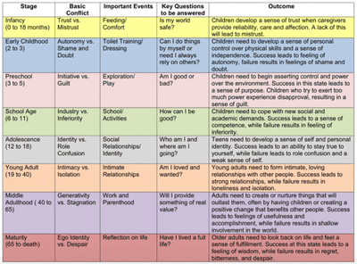

## The Role of Identity and Free Will in the Development of the Self

**Key Terms:**

* **Psychodynamic:** Freud's theory explores the psychological forces influencing human behaviour and emotions, emphasizing their interaction with early experiences.
* **Identity:** The essence of who or what an individual or something is.
* **Free Will:** The capacity to select the type of behaviour one wishes to exhibit; the opposite of being 'determined.'
* **Deterministic:** Our actions stem from inherent qualities and life experiences, contrasting with the concept of 'free will' or voluntary choice.
* **Erik Erikson's 8 Stages of Identity Development:** Founded on Sigmund Freud's psychodynamic idea, Erikson's framework delves into the stages through which individuals develop, encompassing mental and social dimensions across the entire lifespan, from birth to old age, with a focus on identity formation through crises.

* **Erikson's Belief in Free Will:** Erikson contends that free will involves exercising self-control and making rational choices.

### **Diverse Views on Free Will**

1. **Deterministic Perspective:** Actions result from biological factors, influences from upbringing, or external forces, challenging the notion of complete freedom in decision-making.
2. **Jean-Paul Sartre's View:** According to Baumeister, Sartre posits that individuals are accountable for their actions and possess free will.
3. **Immanuel Kant's Perspective:** Baumeister asserts that Kant views free will as centred on self-control and reasoned choices.
4. **Impact on the Justice System:** A belief in free will underpins our justice system.
5. **Enhancement of Prosocial Behavior:** A belief in free will correlates with improved prosocial behaviour.
6. **Emotional and Impulse Control:** Belief in free will contributes to heightened control over emotions and impulses.
7. **Facilitation of Learning from Challenges:** A belief in free will aids individuals in learning from the challenges they encounter.

### **Strengths:**

* Baumeister's perspectives focus on the practical, everyday understanding of acting with free will, emphasizing individual judgment and decision-making.
* Recognition that social psychology can measure free will scientifically lead to experimental advancements, as Baumeister and Munroe (2014) suggested.
* Noteworthy experiments, such as Vohs and Schooler (2008), contribute to exploring and understanding free will through empirical research.

### **Weaknesses:**

* Reducing free will to specific measurable behaviours (reductionism) overlooks the holistic nature of decision-making, neglecting crucial aspects of human intention.
* Actions may appear random, raising questions about whether they stem from free will.
* Experiments like Ebert and Wegner (2011) indicate the potential for mistaking randomness for free will, challenging measurement clarity.