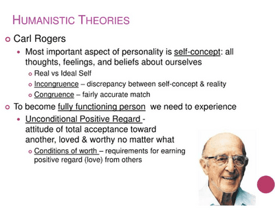
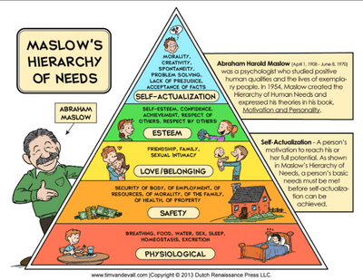

## Humanistic Theory of Self

### Key terms

* **Humanistic Approach:** An investigative approach that comprehensively studies individuals, examining their experiences and interpretations of their surroundings.
* **Self-worth:** The assessment of one's own value, entailing the judgment of one's self-esteem.
* **Unconditional Positive Regard:** The acceptance and support extended to someone regardless of their words or actions.
* **Conditional Positive Regard:** The acknowledgement and approval of an individual with stipulated conditions for acceptance or love.
* **Conditions of Worth:** The criteria individuals believe they must fulfil to be deemed deserving of love.

### **Humanistic Approach Perspective:**

* Views humans as possessing free will and the capacity for transformation.
* Regards individuals as inherently good, endowed with an innate ability to contribute to improvement.

**Key Theories:**

1. **Carl Rogers' Humanistic Theory:**

   * Focuses on the development of self and self-esteem.

   

2. **Abraham Maslow's Hierarchy of Needs:**

   * Explores the prioritized needs essential for individual well-being and development.

**Strengths:**

* Positivity and individual focus characterize this approach.
* Demonstrates practical applications in various contexts.

**Weaknesses:**

* The concepts associated with this approach can be challenging to quantify or measure objectively.
* Applicability is limited to specific situations.

### **Maslow’s Hierarchy of Needs**

**Strengths :**

* Embraces positive psychology, asserting that individuals are inherently good and capable of reaching their full potential.
* Contributes to building a positive culture in society.
* Assists managers in understanding the needs of workers, prioritizing the fulfilment of basic human needs.

**Weaknesses:**

* Tends to centre on Western culture, potentially limiting its universality.
* Concepts lack general measurability and may require empirical evidence to support claims regarding the inherent goodness of humans.