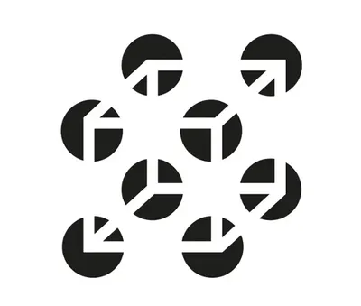
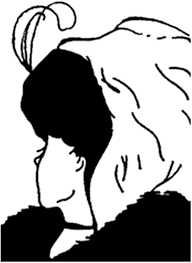
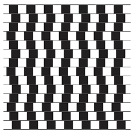

# Perception

## Key Concepts

### **Perception**

* **Depth Perception**: The ability to judge how far away objects are from us
* **Cue:** Information that gives a hint or clue about an item, object or situation
* **Monocular**: using one eye
* **Binocular**: using both eyes
* **Perception**: the way one understands the world through their senses
* **Visual Cliff**: Apparatus that looks like the edge of an elevated platform or cliff

### **Monocular Depth Cue**

* **Superimposition**: When an object is far away from us, items in front of it block out some of the distant objects from our view
* Relative Size- objects look smaller the further away they are
* Linear perspective – parallel lines appear to get closer together the further away from you they get
* Texture gradient- Any texture on the surface of an object appears less defined the further away the object is
* Height in plane- Objects in the distance appear to be higher up in the visual plane than objects closer to us

### **Binocular Depth Cue**

* Stereopsis is the computation of depth information from views acquired simultaneously from different points in space.
* **Priming**: Exposure to a certain stimulus can influence how you respond to a different stimulus later.

### **Visual Constancies**

* The ability of the perceptual system to maintain stable perceptions of objects despite variations in the retinal image.
* Enable individuals to perceive objects as having consistent shape, colour, and size under different viewing conditions.
  * Shape Constancy:
    * The perception that an object maintains the same shape regardless of changes in its orientation or the angle from which it is viewed.
    * Allows individuals to recognize familiar objects even when seen from different perspectives.
  * Colour Constancy:
    * The ability to perceive the consistent colour of an object despite changes in illumination conditions.
    * Ensures that an object is perceived with the same colour under varying lighting environments.
  * Size Constancy:
    * The perception that an object maintains the same size regardless of its distance from the observer.
    * Enables individuals to perceive the actual size of objects rather than their size on the retina.

**Visual Illusions:**

* Perceptual experiences deviate from the actual physical properties of visual stimuli.

* It occurs when the brain interprets visual information differently from the objective reality of the scene.

  * **Fictions:**

    

  * Involve the perception of non-existent elements or features in an image.

  * The brain creates illusory details or patterns not present in the actual visual input.

  * **Ambiguous Figures:**

  

  * Visual stimuli are interpreted in multiple ways, leading to conflicting perceptions.
  * Often, they have dual interpretations, and observers may switch between different perceptual views.
  * **Distortions:**

  

  * Involve perceived alterations in objects' size, shape, or orientation within a scene.
  * Alterations are not reflective of the actual physical characteristics of the stimuli.