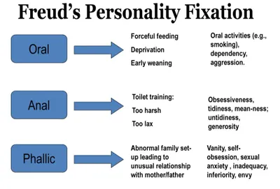

## Freud (1909) Little Hans, Analysis of a Phobia in a Five-year-old Boy

* Study 2: Freud's Analysis of Little Hans' Phobia in a Young Boy
* Background: Freud posited that delving into underlying thoughts could cure mental health issues, aiming to find evidence for psychosexual stages, specifically the Phallic stage, where gender behaviours like the Oedipus complex arise, resolved through identification with a same-sex parent.

### **Aims**

To describe the course of an illness and the subsequent recovery of a five-year-old boy.

### **Procedure**

His parents logged Little Hans's development since age 3. Freud, meeting Hans a few times, studied him, aware of being observed. Three focus areas: studying dreams, analyzing Hans's statements, and examining his phobia of horses through psychoanalysis.

### **Findings**

1. Phobia of Horses: Freud explored Hans's fear of horses, linking it to an experience where a horse fell and died before him. The horse symbolises Hans's father, and the black bits around the mouth represent the father's moustache, supporting the Oedipus complex.
2. Early Dream: Hans dreamt of not having a mother, causing anxiety about losing her. Freud associated this with the Oedipus complex, indicating Hans's unconscious desire for his mother.
3. Giraffe Dream: A dream featuring a giraffe shouting at Hans for taking away a crumpled giraffe. Initially seen as a phallic symbol, Freud later interpreted it as Hans's father reproaching him for taking his mother.

### **Conclusion**

The findings support Freud's theory, particularly the Oedipus complex during the phallic stages.

|Strengths|Weaknesses|
|:---|:---|
|Validity: Qualitative data offers rich detail, enhancing result validity.|Generalizability: Being a case study, results may not represent the wider population.|
|Real-world application: Findings can be applied, for example, in psychoanalysis to treat phobias.|Validity: Interpretation by Freud and Hans's father introduces potential bias, reducing result validity.|
||Ethics: Little Hans may have experienced psychological harm in discussing his phobias.|
