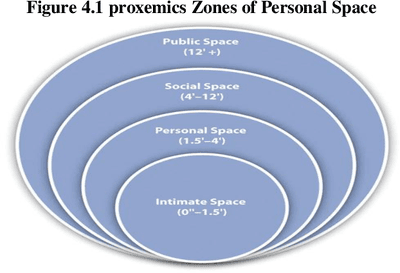

## Non-Verbal Communication

* **Non-verbal communication (NVC):** communication using facial expressions, positioning of the body, gestures, eye contact and the way we speak.
* **Personal space:** the space around us – we can feel uncomfortable if anyone we do not know well invades this space.

**Evolved:** characteristic passed down through our genes because it has survival value.

* NVC encompasses ways of conveying messages without using verbal communication, including facial expressions, body language, gestures, and personal space.

* **Facial Expressions:**

  * **Universal Expressions:**
    * Happiness, sadness, fear, and anger are universally expressed across different cultures.
  * **Components:**
    * Eyebrows, eyes, and mouth play crucial roles in conveying emotions.
    * Pupil dilation can indicate romantic interest.

* **Eye Contact:**

  * **Significance:**
    * The amount of eye contact affects meaning and trust.
    * A steady gaze suggests trustworthiness.
    * Blinking and pupil dilation signify liking.
  * **Cultural Variations:**
    * Aki Myllyneva and Jari Hietanen (2015) found cultural influences on arousal and brain responses during eye contact.

* **Body Language:**

  * **Gestures:**
    * Waving, pointing, and rolling eyes convey messages.
    * Some gestures have cultural meanings.
  * **Postures:**
    * Defensive postures (e.g., crossed arms) convey defensiveness.
    * Open postures are more positive and welcoming.
    * Mirroring is a way people relate when interested.

* **Personal Space and Distance (Proxemics):**

  * Proxemics studies how space affects behaviour, social interactions, and communication.

  

  * **Interpersonal Distances:**
    * Four zones - intimate, personal, social, and public - reflect relationships and comfort levels.
  * **Brain Structure and Personal Space:**
    * Invasion of personal space activates the amygdala, suggesting an emotional response.
    * Individuals without amygdalae exhibit different reactions (Hall, 1963; Myllyneva & Hietanen, 2015).

* **Cultural Differences:**

  * **Non-Verbal Cues:**
    * Beckoning, pointing, eye contact, and gestures can have varied cultural interpretations.
  * **Personal Space:**
    * Edward Hall (1963) introduced Proxemics, studying the impact of space on behaviour and communication.
    * Michael Watson and Theodore Graves (1966) observed cultural differences in seating distances among Arab and US students.
    * Gary Evans, Stephen Lepore, and Karen Allen (2000) suggested that interpersonal distances are more similar between cultures than initially thought.
    * Cultural variations in gestures and reactions to crowding (Watson, 1970; Evans et al., 2000).

* **Challenges in Cultural Interpretation:**

  * Different meanings of gestures, eye contact, and personal space in various cultures.
  * Studies highlight differences in eye contact, nodding, and other non-verbal cues across cultures.