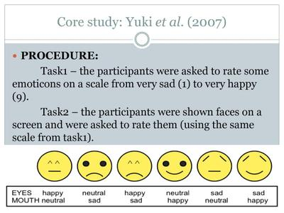

## Yuki et al. (2007), Cultural Differences in Using the Eyes

* **Aim:**
  * Investigate whether emotions are interpreted by focusing on the eyes or mouth.
  * Examine cultural differences between Japan and America in emoticon interpretation.
* **Background:**
  * Emoticons used in computer symbols reflect a cultural emphasis on the eyes (Japan) or mouth (America).
* **Procedure:**
  * Participants: 118 American students and 95 Japanese students.
  * Rated emoticons (happy/neutral/sad eyes and mouths) on a scale from 1 to 9.
  * Six emoticon types were assessed: happy eyes/neutral mouth, neutral eyes/happy mouth, sad eyes/neutral mouth, neutral eyes/sad mouth, happy eyes/sad mouth, sad eyes/happy mouth.

* **Results:**
  * Japanese participants rated emoticons with happier eyes higher (mean = 5.81) than American participants (mean = 2.99).
  * American participants rated emoticons with happier mouths higher (mean = 5.54) than Japanese participants (mean = 4.78).
  * Cultural variations in rating scores for emoticons with conflicting expressions.
* **Conclusions:**
  * Japanese focus more on cues from the eyes; Americans focus more on cues from the mouth.
  * Issues were raised regarding the interpretation of 'happy eye' symbols by American participants.

**Experiment 2: Real Faces and Photographic Cues**

* **Procedure:**
  * Participants: 87 American students and 89 Japanese students.
  * Presented with 60 faces showing combinations of happy, sad, and neutral expressions.
  * Faces appeared for ten seconds; participants rated emotions on the Experiment 1 scale.
* **Results:**
  * Replication of Experiment 1 results.
  * Japanese participants rated faces with happier eyes higher (mean = 4.65) than American participants (mean = 4.33).
  * American participants rated faces with happier mouths higher (mean = 5.48) than Japanese participants (mean = 4.85).
* **Conclusions:**
  * Confirmed findings of Experiment 1: Japanese prioritize cues from the eyes, Americans from the mouth.
  * Inconsistencies in happiness ratings attributed to computer superimposition of eyes/mouths.

**Overall Conclusions:**

* Cultural differences persist in emotion interpretation.
* Japanese emphasize eye cues; Americans focus on mouth cues.
* Challenges in emoticon interpretation by American participants.
* More than eyes or mouths are considered when judging emotions from facial expressions.

|Strengths|Weaknesses|
|:---|:---|
|Standardised Procedure; use of control such as questionnaire and scales/ emoticons; higher reliability|Non-generalisable; however, using Japanese and American students can be generalised towards them, but it can’t be generalised towards Eastern and Western Cultures as a whole.|
|Practical Application: can explain any cultural differences between Americans and Japanese, which is why Japanese can pick up on lies more easily|The ‘faces’ in the study don’t reflect realistic facial expressions, both eye changes and mouth, when smiling, decreasing the ecological validity of the study.|
