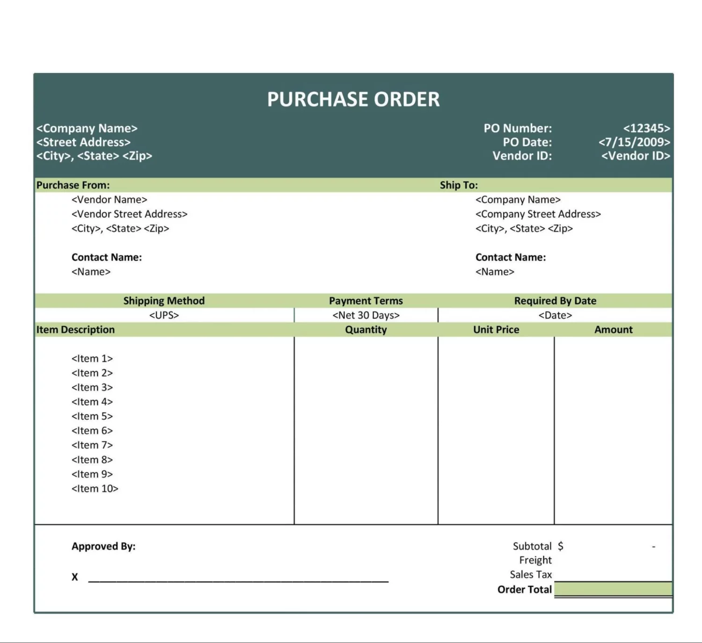

## Purchase Order

When a business or organization decides to buy goods or use the services of another company, it usually issues a purchase order. It usually includes the following :

* Name and address of supplier

* Purchase order number

* Date of order references

* Quantity required

* Delivery date

* Details of the goods and services ordered including part numbers or catalogues

* Authorized signature of a senior member of the company, such as the buyer
  