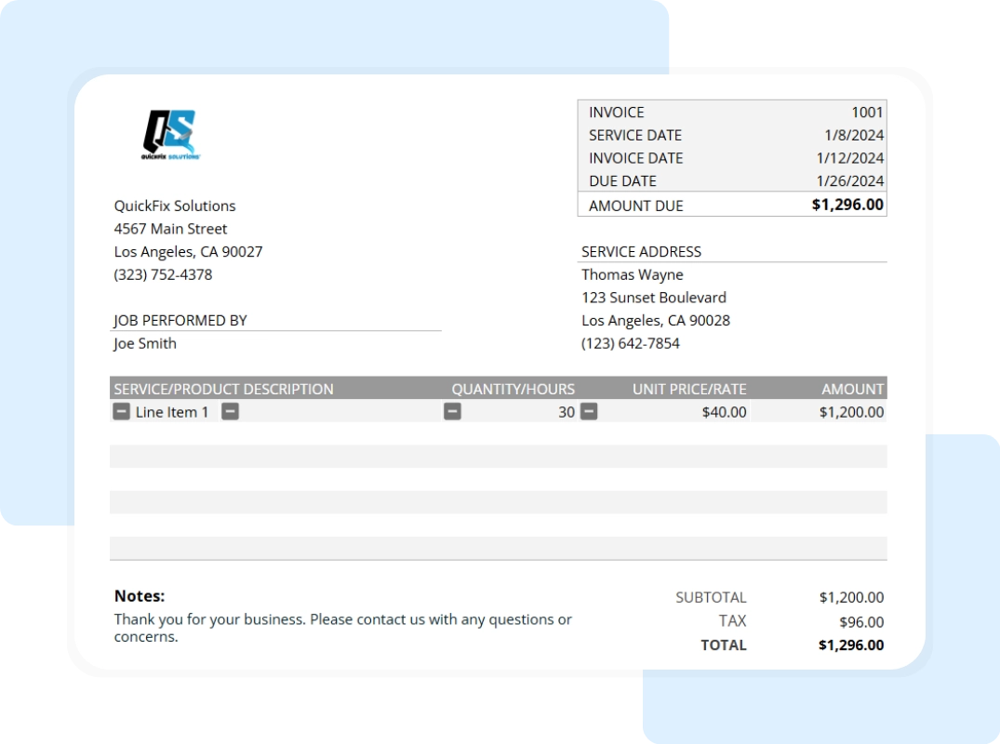

## Invoice

Invoices are issued by suppliers when goods are sold on **credit**. It shows information such as :

* The name of the supplier and customer

* The date of the transaction and all it’s details

* The price depending upon the quantity of goods sold

* Trade discount (if there is one).

Typically, in a question, they’ll ask you to fill out all the details left empty, so it’s important to understand the exact formulas to get the amounts accurately.

* In the quantity box, you must write the amount of goods/products that are being bought.

* Unit cost is referring to the amount of money that must be paid for only one singular good, in this case, the question refers to this as “list price” and it can also be called “sale price” as well.

* Total cost is calculated via multiplying total quantity being bought at the price of only one good. Quantitatively put, it looks like this :

  $$ Quantity x Unit cost = Total cost $$

  * It is the literal price of the quantity sold, all without accounting for trade discounts yet.

* Trade discount means the amount at which a manufacturer reduces the selling price of a product when specifically selling to a reseller. It is usually given as a means to encourage bulk buying from the reseller, strengthening trade bonds. Trade discounts are not applicable to a customer. In an invoice, you must multiply the total cost by the discount percentage and enter that value in the trade discount row. Quantitatively put, it looks like this :

  $$ Total cost x Discount/100 = Trade discount value $$

* Total is just a subtraction of total cost and trade discount value; it is the actual amount you paid. Quantitatively put, it looks like this :

  $$ Total cost – Trade discount value = Total amount paid $$

A customer will record the invoice in their credit purchases, and a supplier will record the invoice in their credit sales.