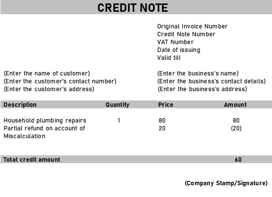

## Credit Note

A credit note is issued when goods have to be returned to the seller due to damage, shortage, overcharges, etc. In other words, it’s issued during a sales return. They are typically printed in red so as not to be confused with an invoice.

* The original copy (also referred to as the top copy) is sent to the customer, who uses it to record their purchase return.

* One copy of the credit note is retained by the seller, who uses it to record their sales return.

Typically, in past papers, they also ask questions based on filling in the empty parts, it has the same method as the invoice.