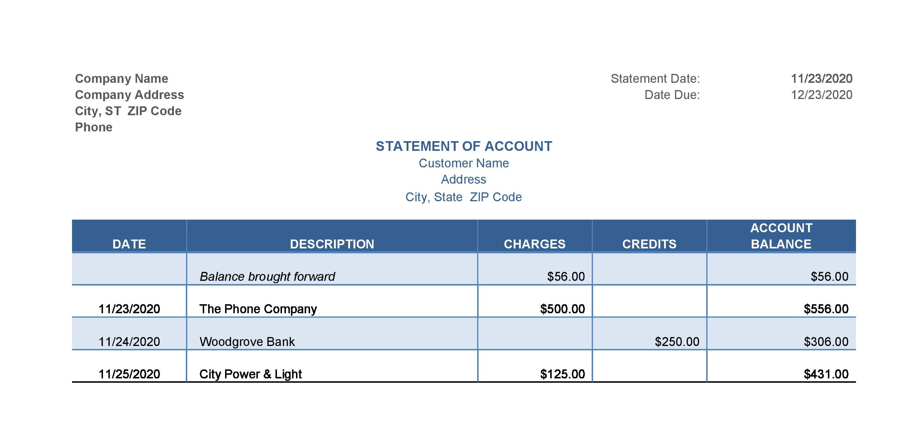

## Statement of Account

Usually, suppliers issue monthly statements of accounts to the customer, it is a summary of all transactions made during the month.

* It shows balances due by the customer and acts as a reminder to the customer of the amount which is due.

