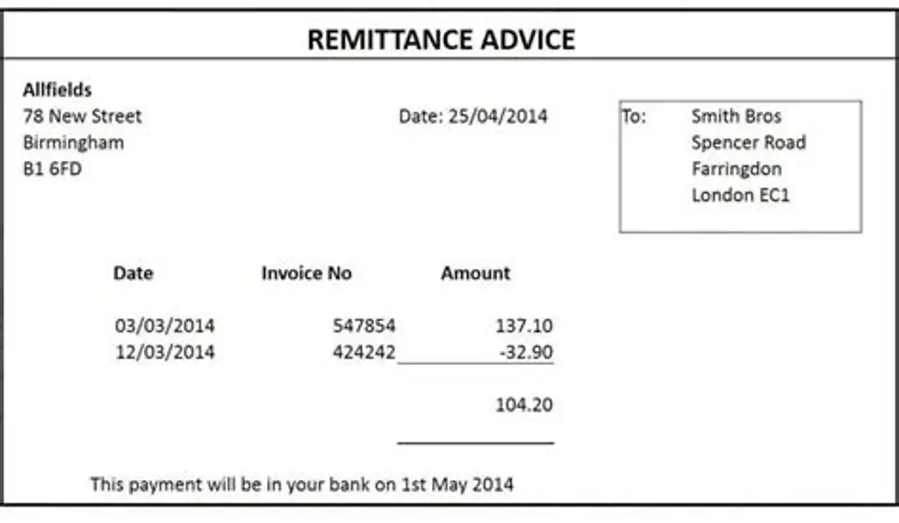

## Remittance Advice

When a buyer pays a supplier, it is important that the supplier has details of the payment so that the money is correctly allocated. Therefore, the buyer usually includes a remittance advice.

* A remittance advice is similar to a statement, as it shows details of the business’s most recent transactions and final balance outstanding.

* Sometimes, it is prepared alongside the statement of account.

* The remittance advice should be accompanied by a cheque to cover the final balance outstanding.

* If the payment is made by the Banker’s Automated Clearing Service (BACS), then a record of this payment should be included with the remittance advice.

* If an invoice is not paid for any reason, it will be left outstanding and then can be queried.

