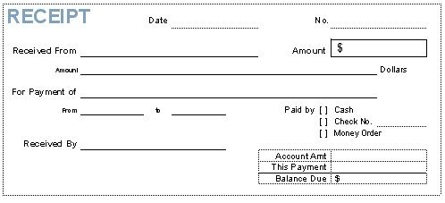

## Receipts

A receipt is a written or printed acknowledgment that a business has received money (cash, check, or digital payment) from a customer or client.

* A member of staff may want to purchase postage from the petty cashier, or perhaps have some photocopying done for their own personal use. 

* In such cases, the petty cashier issues receipts to the staff member for the amount received.

