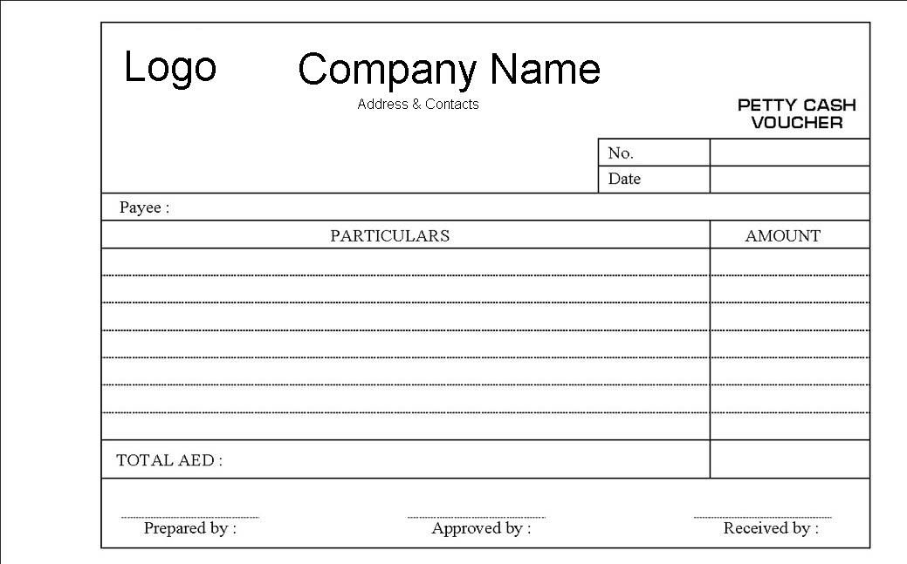

## Petty Cashier Voucher

If a staff member wants to make a claim, they should complete a petty cash voucher.

* The petty cash voucher must show the date and details of the item(s) purchased or expenditure incurred, including VAT if applicable.

* The voucher should be signed by the employee and countersigned by their direct superior/manager.

* If the claim exceeds the authority of the petty cashier, the claim will have to be referred to the senior cashier or accountant.

* Only items of expenditure approved by the business will be reimbursed unless prior agreement has been received for a particular expense claim.

* The petty cash book is a book of original entry from when the items are first entered, i.e. pretty cash vouchers.

