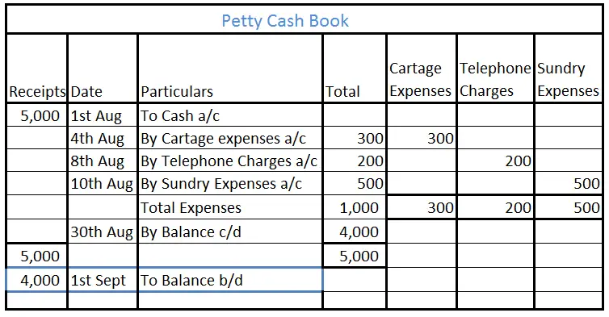

# Petty Cash Book

## Introduction to Petty Cash Book

Petty cash book is a derivative of Cash Book, used to record very small microtransactions that take place within an organization.

* The transactions are daily repetitive transactions such as stationary, food and refreshments, and postage.

* They can weigh on the general cash book and therefore maintained separately to keep the cash book concise and readable.

