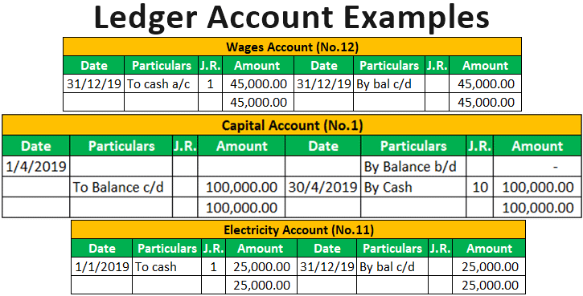

# Ledger Accounts

## Introduction to Ledger Accounts

The ledger is a book of second or final entries of transactions in which each page contains the records of one account, thus a ledger consists of a group of accounts.

* A ledger can either be a computer printout, a bound book, or a loose leaf type book.

