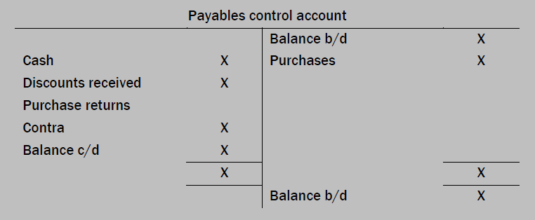

## Trade Payables Ledger Control Accounts

Trade payables means **the people whom you have brought from on credit**

* Meaning you still owe them money for it and are liable to them since they can ask for, they money back at any time, this is a **liability** for you.

The trade payables ledger control account is made as a summary of all transactions related to trade payables during a particular period.

* The Trade Payables Ledger Control Account format is down below.

#|
||

Date

|

Details

|

£

|

Date

|

Details

|

£

||
||

xx/xx/xx

|

Balance b/d

|

xxxx

|

xx/xx/xx

|

Balance b/d

|

xxxx

||
||

xx/xx/xx

|

Returns outward

|

xxxx

|

xx/xx/xx

|

Purchases

|

xxxx

||
||

xx/xx/xx

|

Cash/Bank

|

xxxx

|

xx/xx/xx

|

Refund from Suppliers

|

xxxx

||
||

xx/xx/xx

|

Discount received

|

xxxx

|

xx/xx/xx

|

Interest

|

xxxx

||
||

xx/xx/xx

|

Set off/Contra

|

xxxx

|

xx/xx/xx

|

Balance c/d

|

xxxx

||
||

xx/xx/xx

|

Balance c/d

|

xxxx

|

ㅤ

|

ㅤ

|

ㅤ

||
|#

* It is made to record **only credit** purchase transactions.

* It is written as a list of personal records of the trader’s **suppliers**.

* Your trade payables is a **liability** for you, therefore, opening balance should always be on the credit side by the rules of dead clic.

* The irrecoverable debts account should **never** be written in a trade payables control ledger account.

* Contra or set off accounts should always be on the **debit** side.

