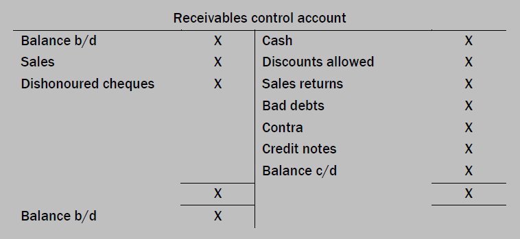

## Trade Receivables Ledger Control Accounts

Trade receivables means **the people who have bought a good from you on credit**

* Meaning they still owe you money for it and they are liable to you since you can ask for the money back at any time, making them your **asset**.

The trade receivables ledger control account is a summary of all transactions relating to trade receivables during a particular period.

* The Trade Receivables Ledger Control Account format is down below.

#|
||

Date

|

Details

|

£

|

Date

|

Details

|

£

||
||

xx/xx/xx

|

Balance b/d

|

xxxx

|

xx/xx/xx

|

Balance c/d

|

xxxx

||
||

xx/xx/xx

|

Revenue

|

xxxx

|

xx/xx/xx

|

Returns inward

|

xxxx

||
||

xx/xx/xx

|

Dishonored cheque

|

xxxx

|

xx/xx/xx

|

Cash/Bank

|

xxxx

||
||

xx/xx/xx

|

Refund to customers

|

xxxx

|

xx/xx/xx

|

Discount allowed

|

xxxx

||
||

xx/xx/xx

|

Interest

|

xxxx

|

xx/xx/xx

|

Irrecoverable debts

|

xxxx

||
||

xx/xx/xx

|

Irrecoverable debts recovered

|

xxxx

|

xx/xx/xx

|

Set off/Contra

|

xxxx

||
||

xx/xx/xx

|

Balance c/d

|

xxxx

|

xx/xx/xx

|

Bank (Irrecoverable debts recovered)

|

xxxx

||
||

ㅤ

|

ㅤ

|

ㅤ

|

xx/xx/xx

|

Balance c/d

|

xxxx

||
|#

* It is made to record **only credit** revenue transactions.

* It is written as a list of personal records of the trader’s **customers**.

* Your trade receivables is an **asset** for you, therefore, opening balance should always be on the debit side by the rules of dead clic.

* The irrecoverable debts you have from your trade receivables is a **liability**; therefore, irrecoverable debts should always be on the credit side by the rules of dead clic.

* Contra or set off accounts should always be on the **credit** side.

