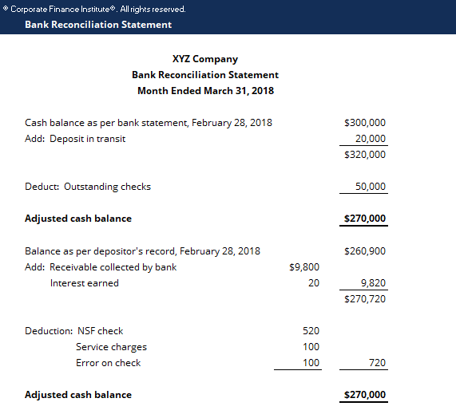

## The Bank Reconciliation Statement

Bank Reconciliation Statement format :

#|
||

Details

|

£

||
||

Balance as per Cash Book

|

xxxx

||
||

Add : Unpresented Cheques

|

xxxx

||
||

Less : Cheque Lodgments

|

(xxxx)

||
||

Balance as per Pass Book

|

xxxx

||
|#

1. Once the balance of the cash book has been found, input it into the bank reconciliation statement.

2. This is the document which shows the difference between the cash book and the bank book, alongside the causes for the differences.

   * Unpresented cheques are cheques which have been issued but not yet presented for payment.

   * Cheque lodgments are refer to funds that have been deposited into a bank account but have not yet been officially credited on the bank statement.

3. After matching the data in the question and relating it to either an unpresented cheque or a cheque lodgment, add the balance per cash book to the unpresented cheques.

4. Subtract that value from the cheque lodgments and write the new total in the row of balance as per pass book.

