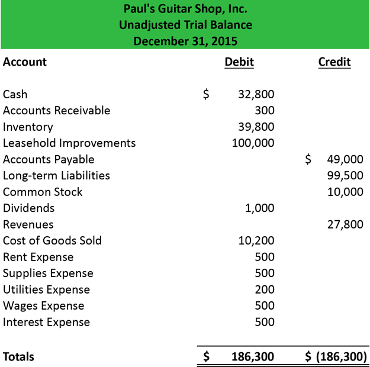

# Trial Balance

## Introduction to Trial Balance

The trial balance is a statement prepared with debit and credit balances of the ledger accounts to **verify the arithmetical accuracy of the book**.

* In a trial balance, it is imperative that both the **debit side and the credit side match up and are equal in amount**.

The uses of a trial balance are as follows :

* To check the arithmetical accuracy of the ledger accounts.

* To locate errors.

* To facilitate the preparation of the final accounts for a year.

