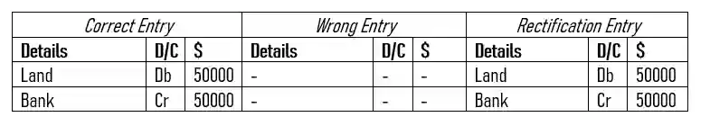

## Error of Omission

* A transaction is completely omitted from the book.

  Example :

  * Suhail did not record purchase of land by cheque, $ 50000.

* The wrong entry done here is the fact that **the entry was not recorded in the books**.

  * Therefore the rectification should be the entering of the correct entry into the ledger.