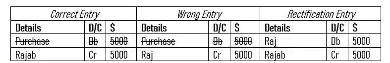

## Error of Commission

* The correct amount on the correct side but in the wrong person’s account.

  Example :

  * Suhail purchased goods from Rajab but recorded it in Raj’s book, $ 5000.

* The wrong entry is in the details column, specifically in Raj, so therefore purchase is correctly entered and can be cut off.

* What has been done wrong is **the use of Raj instead of Rajab**, they incorrectly entered the entry in Raj’s account when it should be in Rajab’s.

  * Write the remaining correct entry as is and the wrong entry on the opposite side.