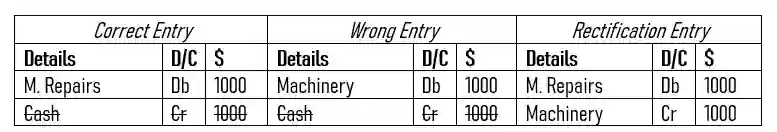

## Error of Principle

* The correct amount on the correct side but the golden rules of accounting are wrong.

  Example :

  * Repairs for existing machinery worth $ 1000 was posted to machinery as a capital.

* The wrong entry is in the details column, specifically in machinery, so therefore cash is correctly entered and can be cut off. 

* What has been done wrong here is the **Use of Machinery and Machinery Repairs**, Machinery is referring to the cost of buying an asset, but the question is talking about Machinery repairs, which is an expense, it is **the wrong classification of accounts**. 

  * Write the remaining correct entry as is and the wrong entry on the opposite side.