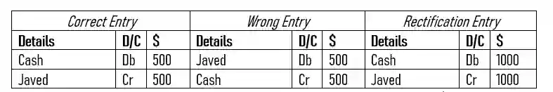
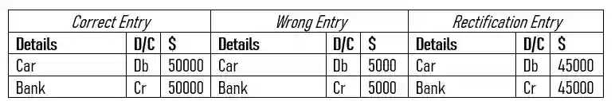
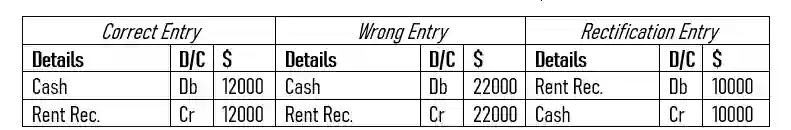

## Error of Original Entry

* A transaction is incorrectly recorded initially in the book of prime entries.

  Example :

  * Cash received from Javed $ 500 was recorded as a payment entry in cash book.

* The wrong entry is in the details column, specifically, they wrote off you receiving $ 500 from Javed as a payment to Javed and therefore incorrectly entered it as per the golden rules of accounting.

* How this differs from the error of complete reversal is the last part of the statement mentioning how this is not an error in the ledger or journal but rather an **error in the cash book**, a book of prime entry.

  * To rectify this, write the entire correct entry as is but double the amount.

### Part two of error of original entry

* A transaction’s amount is written incorrectly.

  Example :

  * A car purchased for 50000 by cheque was recorded as 5000.

* The wrong entry is in the amount column, specifically, the actual amount has been **undercast by $ 45000 in the ledger**.

  * Undercast means the amount has been valued at lesser than it actually was.

  * When an amount is undercast, we are to write the correct entry as is and then subtract the original amount by the wrong amount and enter that into the rectification.

  Example :

  * Rent received in cash of $ 12000 was recorded as $ 22000.

* The wrong entry is in the amount column, specifically, the actual amount has been **overcast by $ 10000 in the ledger**.

  * Overcast means the amount has been valued at higher than it actually was.

  * When an amount is overcast, we are to write the correct entry as the opposite, in other words, switch the debit and credit sides and then subtract the original amount by the wrong amount and enter that into the rectification.