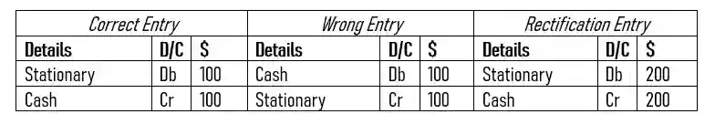

## Error of Complete Reversal

* The correct amount and particulars but the debit and credit have been completely reversed.

  Example :

  * Stationary expense paid $ 100 has been recorded on the debit side of the cash book and credit side of the stationary account.

* The wrong entry is in the details column, specifically, even though **stationary is an expense and therefore should be entered on the debit side**, **it has been incorrectly written on the credit side**.

* Same goes for cash as it was going out and therefore should be written on the credit side yet has been incorrectly written on the debit side. 

  * To rectify this, write the correct entry as is and double the amounts.