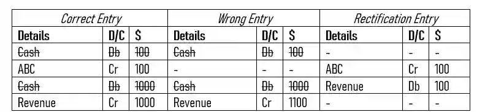

## Compensation Errors

* Two or more unrelated errors compensate for each other in value and end up not affecting the total of the trial balance. Basically, a combination of multiple errors including the ones listed above.

  Example :

  * An amount of £ 100 was received from ABC but was not credited to his account and the total sales daybook was taken as £ 1100 instead of £ 1000.

* In both of the errors listed above, the solution will end up **following the perfect duality concept**, **this leads to it being unnoticeable in the trial balance as the amounts compensate for each other**.

  * Just rectify this as normal and get your answers, most likely questions using a compensation error are unlikely.