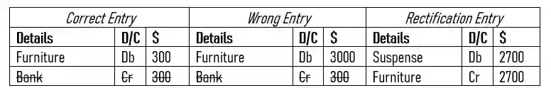
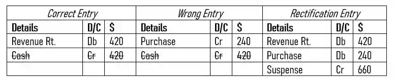

## Suspense Ledgers in Rectification of Errors

Sometimes, when rectifying an error, there might be only one final account whether it’s debit or credit but there won’t be another account to counter it.

* Usually this happens with partly incorrect errors, where only one part of the transaction is wrong, in order for it to follow the duality concept, we place **a suspense account in place of the empty space**.

  Example :

  * Furniture brought for cheque £ 300 was recorded in the furniture account as £ 3000.

* Once the furniture account has been recorded correctly, the empty debit space is left, so put a suspense account to fill it and fulfil the duality concept.

  Example :

  * The total of the sales returns journal, £ 420, had been credited to the purchases account at £ 240.

* The revenue and purchase account have been rectified using the error of principle, leaving out credit, so suspense is entered and the amount is equal to all of the debit accounts in the transaction.

### Suspense Ledgers

Sometimes they may ask you to prepare a suspense ledger.

* In this case, rectify the errors and accordingly apply the rules of the ledger system while only recording the errors with suspense with it.

  * Make sure always record the debit part of the transaction before the credit part of the transaction.