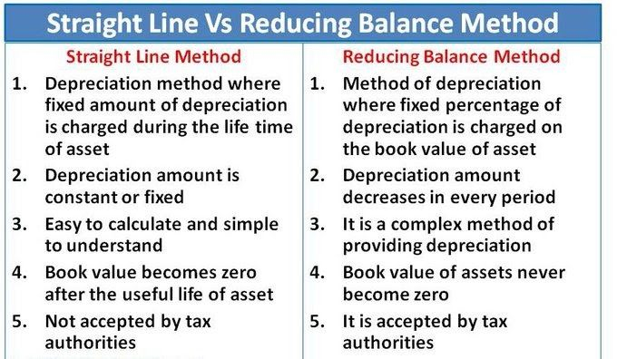

## Methods of Depreciation

1. Straight Line Method

   In this method, depreciation remains the same for every year.

2. Reducing Balance Method

   In this method, depreciation varies every year and decreases.

### Disposal

The estimated amount that will be received when the asset is sold at the end of it’s useful life.

