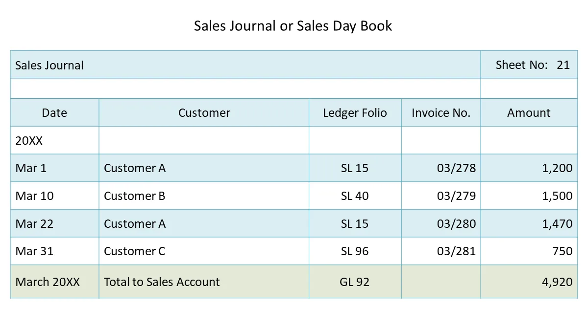

## Sales Day Book

The sales day book/revenue book is a book of original entry in which the details of credit sales of goods are recorded in. Sales day book is made from the **sales invoice**.

* The total of the revenue book shows the total credit revenue of goods during the period concerned. Usually the revenue day book is totaled up every month.

  * The revenue day book is written up daily from the copies of invoices sent out.

* The total of the revenue book is credited to revenue account.

  * Customers whose names appear in the sales day book are debited with the amount appearing against their names. Double entry is thus completed.

