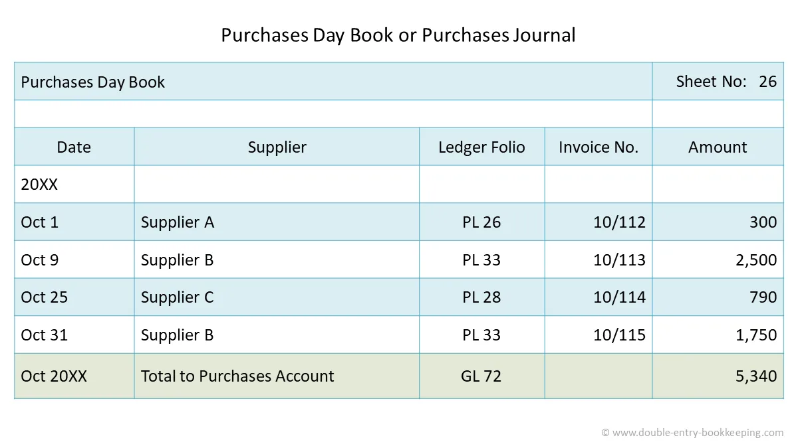

## Purchase Day Book

The purchase day book is an account of the suppliers of a business, documenting from whom the organization has made purchases, what’s been paid for, and how much is still owing. Purchase day book is made from **purchase invoice**.

* Purchase book or purchase day book is a book of original entry maintained to record credit purchases.

  * You must note that cash purchases will not be entered in purchases day book because entries in respect of cash purchases must have entered in the cash book.

* At the end of each month, the purchases book is totaled, the totaled shows the total amount of goods purchased on credit. It is written up daily from invoices received, which are sequentially ordered.

  * The invoice of each number is noted in the purchases book.

