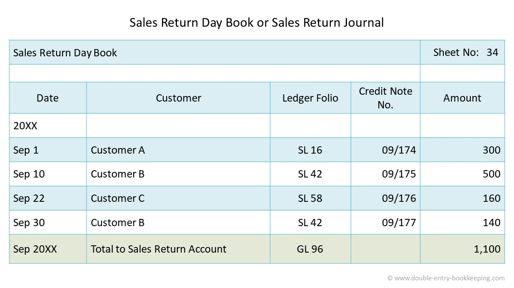

## Sales Return Day Book

Sales returns book is (also called returns inwards book) used for recording goods returned to us by our customers. The ruling of this books is exactly as for sales day books. Sales return day book is made from **credit notes**.

* Customers who return goods should be sent a credit note. It is a statement sent by a business to another person showing the amount credited to the account of the later.

  * Credit notes are serially numbered and are similar in form to the invoices.

