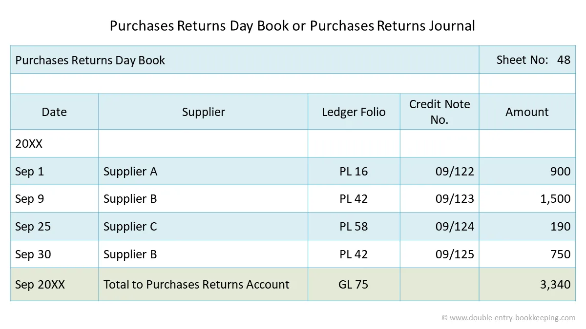

## Purchase Return Day Book

Purchase return day book is a book in which the goods returned to suppliers are recorded. It is also called returns outward book. Purchases return day book is made from **debit notes**.

* Goods may be returned because they are of the wrong kind or not up to sample or because they are damaged etc. The ruling of this book is absolutely the same as the purchases day book and therefore is entered in a similar way as the purchases day book.
* The total of the purchase return day book is credited to returns outward account or purchase return account. Individual suppliers to whom goods are returned are debited. This is due to the golden rules of accounting.
* When the goods are returned to the suppliers, an intimation is sent to them through what is known as a debit note. A debit note is a statement sent by a businessman to another person, showing the amount debited to the account of the later.
  * A debit note is a statement, sent by a businessman to another person, showing the amount debited to the account of the later.

