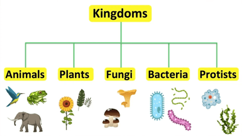

## Variety of Living Organisms

All living beings are classified under **five** kingdoms:

**Plants**

* All plants are **multicellular** organisms.
* Their cells contain **chloroplasts**. Therefore, they **can carry out photosynthesis.**
* All plants have **cell walls** that are made up of a complex carbohydrate called **cellulose**.
* They **store carbohydrates** as **starch** or **sucrose**.
* Examples include flowering plants, such as cereal (maize), and herbaceous legumes (peas or beans).

**Animals**

* Animals, like plants, are also **multicellular** organisms.
* Their cells **do not contain chloroplasts** and cannot **carry out photosynthesis**. They acquire their nutrition by feeding on other plants and animals.
* Their cells **do not have cell walls**; this enables them to change shape, which is essential in allowing them to move from place to place.
* Movement in animals usually involves **nervous coordination.**
* Unlike plants, animals often **store carbohydrates** as **glycogen.**
* Examples include mammals (for example, humans) and insects (for example, houseflies and mosquitoes).

**Fungi**

* Fungi can be **multicellular** or **unicellular** organisms.
  * Examples of multicellular fungi are mushrooms, toadstools, moulds and Mucor (which has a typical fungal hyphal structure).
  * An example of a unicellular organism is yeast.
* Fungi are organisms that cannot **carry out photosynthesis** because of the absence of chloroplasts.
* Their body is usually organised into **mycelium**, produced by the network of fungal hyphae.
  * Hyphae are thread-like filaments in the cells of fungi.
* Hyphae are not divided into individual cells, so the cytoplasm of hyphae contains **many nuclei**.
* Fungi have **cell walls** made of **chitin**.
* They feed by extracellular secretion of digestive enzymes onto food material and absorption of the organic products.
* When an organism feeds on dead organic material through extracellular digestion, it is called **saprotrophic nutrition.**
* Fungi may **store carbohydrates** as **glycogen**.

**Protoctists**

* Most are **microscopic single-celled** organisms.
* Some, like Amoeba, live in pond water and have features like animal cells. These are known as protozoa.
* Some, like Chlorella, have chloroplasts and are more like plants. These are known as algae.
  * Most algae are unicellular, but some species, such as seaweed, are multicellular.
* Some are pathogenic, such as Plasmodium, which is responsible for causing malaria.

**Prokaryotes**

* The primary forms of prokaryotic organisms are **bacteria.**
* They are **single-celled** and **do not contain a nucleus**.
* They are smaller than eukaryotic cells.
* Their nuclear material is usually found in the cytoplasm instead. Their DNA is in a **single circular chromosome.**
* All bacteria have a **cell wall** made up of **peptidoglycan.**
* Some bacteria have a **slime layer** or **capsule** surrounding the cell wall for extra protection.
* Some bacteria can swim with the help of **flagella.**
* About 3/4 of bacteria have **plasmids** (circular rings of DNA).
* Examples include Lactobacillus bulgaricus, a rod-shaped bacterium used to produce yoghurt from milk, and Pneumococcus, a spherical bacterium that acts as the pathogen causing pneumonia.