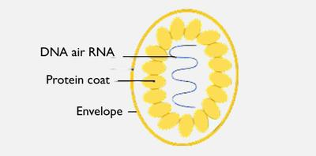

## Pathogens

Pathogens are **microorganisms** that cause **diseases** in other organisms.

* They include protoctists, fungi, bacteria and viruses.
* **Viruses**
  * All viruses are **parasites**, so they **can only reproduce in a host.**
  * They are smaller than bacteria.
  * They have no cellular structure, composed **only** of **genetic material** (DNA or RNA), surrounded by a **protein coat.**
  * They are not living organisms as they do **not carry out all the life processes.**
  * Viruses can infect every type of living organism.
  * They have a wide variety of shapes.
  * **Examples include:**
    * Tobacco mosaic virus that causes discolouring of the leaves of tobacco plants by preventing the formation of chloroplasts
    * Influenza virus that causes ‘flu’
    * HIV that causes AIDS.

 