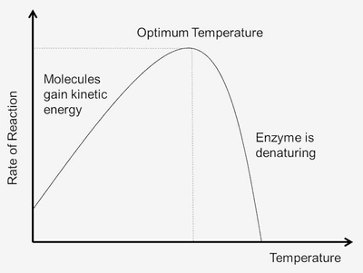
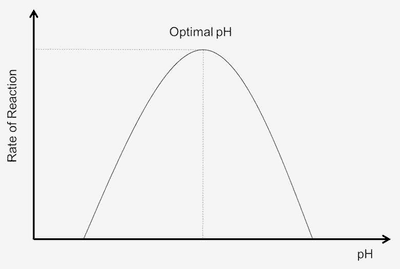

## Biological Molecules

The macromolecules in our bodies are:

* **Carbohydrates**
* **Proteins**
* **Lipids**

These are large molecules made up of smaller basic units called monomers.

### **Carbohydrates**

* Main source for supplying body cells with energy
* Made up of the elements carbon, hydrogen and oxygen
* Most of the carbohydrate in our body comes from **starch**:
  * Large, insoluble molecule
  * Polymer of **glucose**
  * Storage carbohydrates in many plants, such as potatoes, rice and wheat
  * Food sources of starch include bread and pasta
* **Three main types are monosaccharides, disaccharides and polysaccharides**
  * Examples of monosaccharides include glucose and fructose (fruit sugar)
  * Examples of disaccharides include sucrose, lactose and maltose
  * Examples of polysaccharides include starch, glycogen and cellulose
* **Test for starch**: Add yellow-brown iodine solution to the food sample; it will turn blue-black in the presence of starch.
* **Test for glucose**: Heat Benedict’s solution gently after adding the reducing sugar (glucose); it will turn from blue to brick-red in the presence of glucose.

| Monosaccharides | Disaccharide |
|----|----|
| Glucose + Glucose | Maltose |
| Glucose + Fructose | Sucrose |
| Glucose + Galactose | Lactose |

### **Proteins**

* Made up of the elements carbon, hydrogen, oxygen, nitrogen and sometimes sulfur
* Needed for growth and repair of tissues
* The building blocks for proteins are **amino** **acids**.
* There are about 20 different amino acids in living organisms.
* Meat, cheese, fish and eggs are rich in protein.
* Plant material usually contains less protein, but beans, peas and nuts are rich in protein.
* Change in the order of the amino acids changes the chemical structure of the protein, leading the different proteins being produced.
* **Test for Proteins:** Add the protein sample to Biuret’s solution; it will turn from blue to purple in the presence of proteins.

### **Enzymes**

* These proteins are biological catalysts that speed up the reaction rate without being used up.
* Enzymes work by lowering the activation energy ( the amount of energy needed for a reaction to begin).
* **The** **Lock** **and** **Key** **Theory**: Substrates collide with the active site of the enzymes and will only bind to it if the active site is exactly complementary to the substrate.
* Factors that affect the enzyme activity:
  * **Enzyme concentration**
  * **Substrate concentration**
  * **Temperature**
    * The higher the temperature, the higher the kinetic energy, which causes more successful collisions between the substrate and the active site of the enzyme, increasing the rate of reaction.
    * Past the optimum temperature, the enzyme **denatures** by breaking the bonds, causing the active site to deform and change shape, which prevents it from binding to a substrate.

       
  * **pH**
    * A pH that is too acidic or alkaline will change the shape of the active site, preventing the enzyme from forming an enzyme-substrate complex, and causing the reaction rate to decrease.
    * **Buffer solutions** are solutions that can resist changes in pH. Different pH values can be obtained by preparing different buffer solutions. Buffer solutions are important in experiments investigating the effect of pH on enzyme activity.

 

### **Lipids**

* It consists of the elements carbon, hydrogen and oxygen.
* The building blocks for lipids are **glycerol molecules** and **three fatty acids.**
* **Test for Lipids:** After adding the sample of lipid to the test tube, add ethanol and gently shake it. Add cold water to it; a white cloudly layer will form.

