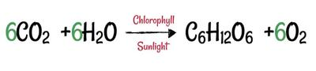
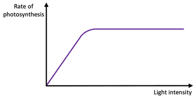
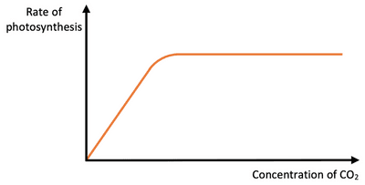
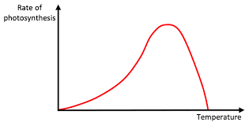

## Nutrition in Flowering Plants

* **Photosynthesis**: The process by which plants use light energy trapped by chlorophyll to turn carbon dioxide and water into glucose.
* Light energy is converted into chemical energy in the process of photosynthesis.

 **Factors Affecting Photosynthesis**

* **Light Intensity:** The higher the light intensity, the higher the rate of photosynthesis.

 

* **Carbon Dioxide Concentration:** The higher the carbon dioxide concentration, the higher the rate of photosynthesis.

 

* **Temperature:** The higher the temperature, the higher the kinetic energy, increasing enzyme activity and, hence, a higher rate of photosynthesis. But, after the optimum temperature, the photosynthesis rate decreases as the plant cell's enzymes denature.

 

* **Minerals required for the growth of the plant:**
  * **Nitrate:** For making amino acids, proteins and DNA
    * Deficiency of nitrate:

      Limited growth of the plant

      Older leaves turn yellow
  * **Magnesium:** For the production of chlorophyll
    * Deficiency of magnesium:

      Leaves turn yellow
  * **Potassium:** For enzymes needed in photosynthesis and respiration
    * Deficiency of potassium:

      Leaves turn yellow with dead spots
  * **Phosphate:** Helps in making DNA and is part of the cell membrane
    * Deficiency of phosphate:

      Poor root growth

      Younger leaves turn purple

