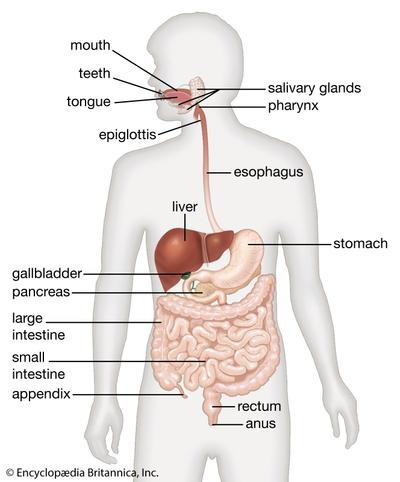

## Nutrition in Humans

* A **balanced diet** includes the appropriate proportions of carbohydrates, proteins, lipids, vitamins, minerals, water and dietary fibres.

| Food | Source | Function | Deficiency |
|----|----|----|----|
| **Carbohydrates** | Bread, rice, pasta | The body’s main fuel for energy |    |
| **Lipids** | Cheese, eggs | Used to make the cell membrane |    |
|    |    | They are used for insulation. |    |
|    |    | They are used as an energy store. |    |
|    |    | Used to protect organs from mechanical damage |    |
| **Proteins** | Meat, fish, cheese | Used for growth and repair of tissues | kwashiorkor |
| **Vitamin A** | Fish liver oils, butter, margarine, carrots | Makes a chemical in the retina \n  | Night blindness |
|    |    | Protects the surface of the eye | Damage to the cornea of the eye |
| **Vitamin C** |    | Sticks the cells lining the surface together to form connective tissues. | Scurvy |
| **Vitamin D** |    | It helps bones absorb calcium and phosphate | Rickets |
|    |    |    | Poor teeth |
| **Minerals** | Red meat, dairy products, vegetables | Calcium helps to make teeth and bones |    |
|    |    | Iron in part of haemoglobin in red blood cells that helps to carry oxygen |    |
| **Water** |    | Maintains osmosis in cells |    |
|    |    | Essential components of blood plasma |    |
|    |    | Provides solvent for enzymes and food molecules |    |
| **Dietary fiber** | Whole-grain cereal, fruits and vegetables | Helps in peristalsis |    |
|    |    | Helps prevent constipation |    |

* **Factors affecting energy requirements include:**
  * Activity levels
  * Age
  * Pregnancy

### **Digestion**

 

* **Digestion** is the chemical and mechanical breakdown of food. It converts large insoluble molecules into small soluble molecules, which can be absorbed into the blood.
* **Parts of the human alimentary canal**
  * **Mouth:**
    * The teeth break down the food into smaller pieces to increase the surface area of enzymes.
    * The enzyme salivary amylase breaks down starch in food to maltose
  * **Oesophagus**: Muscular tube that contracts to force the food down into the stomach through peristalsis
    * **Peristalsis:** Waves of muscular contractions that push food along the gut.
  * **Stomach:**
    * The stomach walls release low-pH hydrochloric acid to kill bacteria in the food and prevent food poisoning.
    * The enzyme pepsin breaks down proteins into peptides
  * **Small intestine:** Made up of the duodenum and ileum
  * **Duodenum**: Several digestive enzymes are added to the duodenum. These are made by the pancreas and liver
    * Pancreatic juice from the pancreas contains trypsin, lipase, and amylase to help absorb the food into the bloodstream
      * Trypsin breaks down proteins into peptides
      * Lipase breaks down lipids into fatty acids and glycerol
      * Amylase breaks down starch to maltose
    * The liver makes bile, which is released into the duodenum to emulsify large lipids, increasing the surface area for lipase to work on. The bile is stored in the gall bladder before releasing it into the duodenum.
    * Bile and pancreatic juice are both alkaline, so they help neutralize the hydrochloric acid around the food.
    * The walls of the small intestine also release digestive enzymes:
      * Protease breaks down peptides into amino acids
      * Maltase breaks down maltose to glucose
  * **Ileum**: Food molecules are absorbed into the bloodstream.
  * **Adaptations of the small intestine for absorption**
    * High surface area to volume ratio due to villi and microvilli lining the tube
    * Long, so large surface area
    * Each villus contains a network of blood capillaries, so steep concentration is maintained by the blood flow for nutrients to be absorbed.
    * The lacteal tube in the middle of the villus absorbs digested lipids into the lymphatic system.
    * Villus has only a single layer of epithelium cells, so it is a short distance for diffusion.
    * The epithelium cells have many mitochondria needed to transport some substances.
  * **Large intestine**: Made up of the colon, rectum and anal canal.
  * **Colon:** Absorbs most of the water back into the bloodstream, producing faeces.
  * **Rectum:** Stores the faeces
  * **Anus:** Expels the faeces from the rectum out of the body

