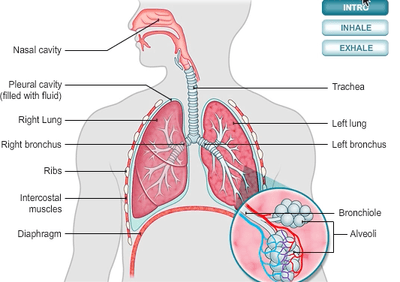
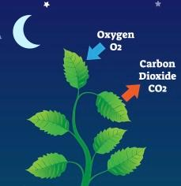
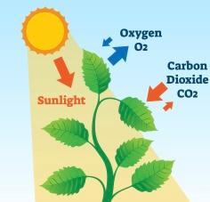

## Gas Exchange

### **Gas Exchange in Humans**

 

* The gas exchange system consists of the thorax, including the ribs, intercostal muscles, diaphragm, trachea, bronchi, bronchioles, alveoli and pleural membranes.
* Movement of air from the atmosphere to the alveoli

  Nose/Mouth → Trachea → Bronchi → Bronchiloes → Alveoli
* **Inhalation:**
  * External intercostal muscles contract and pull the ribcage up and outwards
  * The diaphragm contracts and flattens
  * Volume in the chest cavity increases, causing the air pressure in the thorax to decrease, which draws air in
* **Exhalation**:
  * External intercostal muscles relax and pull the ribcage in and downwards
  * Diaphragm relaxes
  * Volume in the chest cavity decreases, causing air pressure in the thorax to increase.
* **Adaptations of the lungs for gas exchange:**
  * A large number of alveoli to increase surface area for gas exchange
  * Alveoli have a moist lining for gases to diffuse more easily
  * A network of capillaries surrounds the alveoli to maintain a steep concentration gradient for the diffusion of gases.
  * The walls of alveoli are one-cell thick to reduce the distance for diffusion.
* **Effects of smoking:**
  * **Lung cancer**: Tar in tobacco contains cancer-causing chemicals called carcinogens
  * **Bronchitis**: Infections from bacteria and irritation of the airways can cause bronchitis. Smoking destroys and paralyzes the cilia lining the airways so the mucus cannot be swept away from the airways. Thus, this leads to the narrowing of the lumen and infections.
  * **Emphysema:** The alveoli walls break down and fuse, reducing the surface area for gas exchange. This leads to the affected person's blood carrying less oxygen, so less respiration occurs in their cells, and the person feels fatigued.
  * **Coronary heart disease**: Smoking leads to the coronary arteries becoming damaged and constricting, so less oxygen is delivered to the heart cells for respiration. The heart muscle can die, resulting in a heart attack.
  * Cigarette smoke also contains carbon monoxide, which has a strong affinity for haemoglobin, leading to less oxygen being delivered around the body.

### **Gas Exchange in Flowering Plants**

 

### **Adaptations of the Leaf for Gas Exchange**

* Broad to increase surface area to volume ratio for gas exchange
* Thin to shorten diffusion distance for the gas exchange
* Contains airspaces to allow gas exchange
* Contains stomata which are responsible for the diffusion of gases

### **Gas Exchange during Respiration**

* Respiration happens throughout the day, but at night, without daylight, photosynthesis stops, and only respiration occurs.
* During respiration, plants will require **oxygen** and glucose to be able to produce energy (ATP)
* This means oxygen enters the leaf through the stomata while carbon dioxide diffuses.
* At night, the stomata close to prevent loss of water.

 

### **Gas Exchange during Photosynthesis**

* During the daylight, mainly photosynthesis occurs: The overall uptake of carbon dioxide is more than oxygen.
* At higher light intensities, plants carry out photosynthesis at a much higher rate when compared to respiration.
* Plants need **carbon dioxide** and water to carry out photosynthesis to produce glucose.
* That means carbon dioxide enters the leaf through the stomata while oxygen exits the leaf.

##  