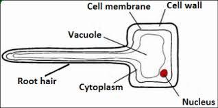

## Transport

### **Transport in Humans**

* Unicellular organisms can rely on diffusion to supply the body's needs:
  * Have a large surface area to volume ratio
  * Low metabolic demand
* Multicellular organisms have small surface area to volume ratio
* Multicellular organisms usually have a mass transport system, as diffusion is insufficient to supply the demands of these organisms.
* **The composition of the blood**
  * **Red blood cells**
    * Carry oxygen around the body
    * Have biconcave disc shape to increase surface area to volume ratio
    * Contains haemoglobin that binds to oxygen
    * No nucleus to make space for more haemoglobin
    * Thin shape for short diffusion distance
  * **White blood cells**
    * **Phagocytes:**
      * Perform phagocytosis by engulfing the pathogen and releasing digestive enzymes to break it apart
      * They have a large spherical or lobed nucleus
      * They can change their shape
      * Their pseudopodia can surround bacteria during phagocytosis
    * **Lymphocytes**
      * Large spherical nucleus
      * Around the same size as RBCs
      * Produce antibodies to destroy micro-organisms
      * The antibodies released during the immune response complement the antigen on the pathogen.
  * **Platelets**
    * Fragments of large cells made in the bone marrow
    * During blood clotting, platelets produce a chemical that causes the soluble protein fibrinogen to be converted to insoluble fibres of fibrin.
      * Fibrin traps RBCs and platelets, forming a clot across the wound. This prevents blood loss and entry of microorganisms.
  * **Plasma**
    * It is responsible for carrying substances around the body, such as:
      * Carbon dioxide
      * Urea
      * Digested food
      * Hormones
    * It distributes heat around the body

### **Transport in Plants**

* **Phloem**
  * Transports the products of photosynthesis between the leaves and other parts of the plant.
  * The end wall of each cell of the phloem has pores forming the sieve plates
  * The cytoplasm extends through the holes of the sieve plate to form the sieve tube.
  * It consists of living cells.
  * It has a companion cell beside the sieve tube to control the movement of substances.
* **Xylem**
  * Transports water and mineral ions from the roots upwards.
  * There is only a unidirectional movement of substances, unlike in the phloem.
  * Made of dead cells called lignin that strengthen its turgidity
* **The root hair cell**

   
  * Has a long projection
    * To increase surface area for absorption of water and mineral ions
    * To penetrate through the soil particles to reach the water
  * Concentrations of solutes inside the root hair cell is more than in the soil
    * Allows water to enter the root hair cell by osmosis
  * The cell wall of the root hair cell is thin
    * Easier diffusion, as a short diffusion path
  * Has no chloroplast
    * It is underground, so no sunlight reaches it for photosynthesis
* **Transpiration**: the evaporation of water from the surface of the plant
* **Factors that affect the rate of transpiration:**
  * **Humidity:** The transpiration rate decreases in humid air because the diffusion gradient decreases as water collects near the leaf's stomata.
  * **Wind speed:** The transpiration rate increases as the wind speed increases because the moving air removes water vapour near the stomata, increasing the diffusion gradient.
  * **Temperature:** The rate of transpiration increases as the temperature increases because the rate of evaporation from the mesophyll cells increases.
  * **Light intensity:** The rate of transpiration increases as the light intensity increases because the stomata of the leaves open for photosynthesis.

