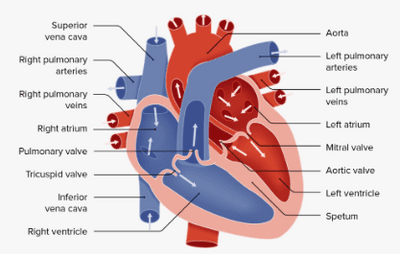
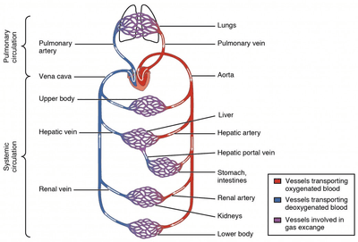

## Structure of the Heart

 

* Deoxygenated blood from the rest of the body enters the heart through the vena cava and into the right atrium.
* Blood is then pushed through the tricuspid valve and into the right ventricle, passing through the pulmonary valve and into the pulmonary artery to be taken to the lungs.
* Oxygenated blood from the lungs enters through the pulmonary vein, passes the bicuspid valve, into the left ventricle, where it’s pushed through the aortic valve and finally to the aorta to be transported to the rest of the body.
* A septum separates the left side and the right side
* The left ventricle has thicker walls than the right because the left ventricle pushes the blood to the aorta, where it’s transported to the rest of the body, hence requiring high pressure. In contrast, the right ventricle pushes blood to the pulmonary artery to be transported to the lungs which is in short distance hence high pressure wouldn’t be required.

   
* When we exercise, our heart rate increases, as more energy is needed for our muscles to respire; thus, more nutrients and oxygen in the blood need to be supplied faster.
* When we are angry or scared, our heart rate increases because adrenaline is released, stimulating the ‘fight or flight’ response.
* Coronary heart disease is caused due to the build-up of plaque in the coronary arteries, reducing blood supply to the heart muscle. This may lead to the heart muscle dying as it is unable to respire, resulting in a heart attack.
* **Risk factors for coronary heart disease**
  * Smoking
  * High blood pressure
  * Heredity
  * Diet
  * Stress
  * Inactivity
* **Structure of the Artery**
  * Thick wall: To withstand high pressure
  * Muscular wall: To maintain the high pressure of blood
  * Elastic wall: To allow the artery to stretch and recoil
  * Smooth endothelial layer: To reduce friction between the inner wall of the artery and the blood
  * Narrow lumen: To maintain high pressure
* **Structure of the Vein**
  * Thin wall
  * Less muscular and less elastic wall compared to the artery
  * Wider lumen
  * Valves: To prevent the backflow of blood
* **Structure of the Capillary**
  * One-cell thick: Short diffusion path

