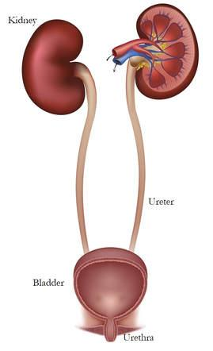
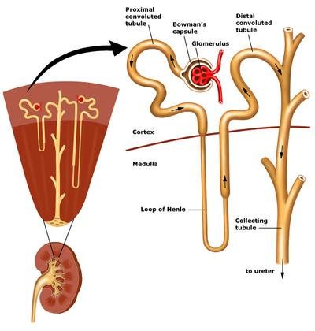

## Excretion in Humans

* **Osmoregulation**: Maintaining a stable concentration of water in the body
  * **In the case of dehydration:**
    * The hypothalamus detects the low amount of water in the blood
    * The pituitary gland releases more anti-diuretic hormone (ADH)
    * More water is reabsorbed back into the bloodstream in the collecting duct
    * Urine becomes more concentrated as there’s less water in it
  * **In case of too much water**
    * The hypothalamus detects high amounts of water in the bloodstream
    * The pituitary gland releases less ADH
    * Less water is reabsorbed back into the bloodstream in the collecting duct
    * Urine is diluted as there’s lots of water in it
* The urinary system consists of the kidney, ureter, bladder and urethra.

   
* **The Structure of the Nephron**
  * **Bowman’s Capsule**: The bowman’s capsule surrounds a coiled ball of arteries called the glomerulus
  * **Glomerulus:** The pressure in the glomerulus is very high, so it forces the blood out of it into the bowman’s capsule
  * **Basement Membrane** filters the blood, allowing only small molecules to pass through it, and prevents large molecules like proteins from entering the nephron.
    * The fluid that enters the nephron is called the glomerular filtrate
    * The process of filtering different-sized molecules in the bowman’s capsule is called ultrafiltration
  * **First coiled tubule:** In the proximal convoluted tubule, all the glucose is reabsorbed back into the blood by selective reabsorption.
  * **Loop of Henle:** Most of the water is reabsorbed back into the blood, as well as sodium and chloride ions.
  * **Distilled convoluted tubule**
  * **Collecting Duct:** The remaining water is reabsorbed
* The urine contains urea, water and ions like chloride.

 