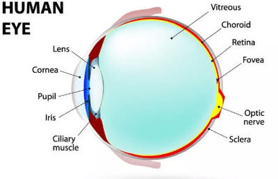
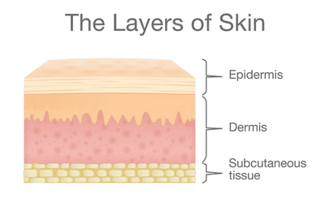

## Coordination and Response in Humans

* Organisms can respond to changes in their environment.
* Homeostasis is the maintenance of a constant internal environment
* Body water content and body temperature are both examples of homeostasis
* **Coordinated response**

Stimulus → Receptor → Coordination → Effector → Response

|Nervous system|Endocrine system|
|:---|:---|
|Nerve impulses are transmitted through neurons|Hormones are transmitted through the bloodstream|
|Usually, it has an instant effect|It takes longer to have an effect|
|Has a localised effect|It can have a widespread effect on different organs|
|Short-lived response|Usually longer-lasting response|

* The central nervous system consists of the brain and spinal cord and is linked to sense organs by nerves.
* The stimulation of receptors in the sense organs sends electrical impulses along nerves into and out of the central nervous system, resulting in rapid responses.

### **Synaptic Transmission**

* The impulses reach the end of the axon called the terminal button
* It stimulates the vesicles to release the neurotransmitters
* The neurotransmitters move across the synapse
  * A synapse is a gap between two neurons
* It attaches itself to the receptor on the second neuron
* The impulse continues in the second nerve cell
* Enzymes digest the neurotransmitters

### **Reflex Arc**

* The reflex arc, concerning the withdrawal of your finger from a hot object, works by:
  * The sensory receptors in your finger detect the stimulus
  * The sensory neuron carries the impulse to the relay neurone
  * The relay neuron then has the impulse to the effector neurone
  * The effector neurone causes the effector (muscle) to contract, moving the finger away from the hot object
* A **Reflex Action** is an automatic, involuntary response to a stimulus

### **The Eye**

* The eye is considered a receptor
* **Parts of the eye**
  * **Sclera:** Tough outer coat of the eye

  * **Cornea:** Transparent layer in front of the eye that allows light to enter the eye; it also refracts the light as it enters the eye

  * **Iris:** Colored part of the eye, which has muscles to change the size of the pupil

  * **Pupil:** Allows light to enter the eye

  * **Choroid:** Dark layer of tissue below the sclera of the eye, containing blood vessels and pigment cells to prevent reflection of light

  * **Retina:** Light-sensitive layer at the back of the eye

  * **Optic nerve:** Nerve carrying impulses from the retina to the brain

  * **Fovea:** Region at the centre of the retina of the eye where there is a high concentration of light-sensitive receptor cells

  * **Blind spot:** Area of the retina where the optic nerve leaves the eye, which contains no light-sensitive cells, so an image cannot be detected

    
* **Iris reflex**
  * **In bright light**
    * Circular muscles contract
    * Radial muscles relax
    * Pupil constricts
  * **In dim light**
    * Circular muscles relax
    * Radial muscles contract
    * Pupil dilates
* **Accommodation:** The changes that take place in the eye that allow us to see objects at different distances
  * To focus on distant objects
    * Ciliary muscles relax
    * Suspensory ligaments pulled tight
    * The lens becomes less convex (flattens)
  * To focus on nearby objects
    * Ciliary muscles contract
    * Suspensory ligaments slack
    * The lens becomes more convex (rounded)

### **Skin**

* The skin is an organ responsible for:
  * Forming a tough outer layer, resisting mechanical damage

  * Protects from pathogens

  * Forms an impermeable surface, preventing loss of water

  * Acts as a sense organ

  * Controls the loss of heat

    
* **Response to changes in temperature**
  * **Hot temperature**
    * The sweat glands produce sweat
      * This is secreted onto the surface of the skin
      * When sweat evaporates, it turns to gas
      * The energy this change needs is the latent heat of vaporisation.
      * The heat from the body is used to evaporate the sweat, thus cooling the body.
    * Hairs on the skin lie flat against the skin's surface.
      * The hair erector muscles relax
    * **Vasodilation**
      * Arterioles leading to the capillary loops dilate
      * This increases blood flow to the skin’s surface
      * Heat is radiated away from the body
  * **Cold temperature**
    * Hairs on the skin trap a layer of air
      * Air is a poor conductor of heat, thus acting as insulation.
    * The body's metabolism speeds up to generate more heat.
    * Shivering causes the muscles to contract and relax rapidly, generating a large amount of heat.
    * **Vasoconstriction**
      * Arterioles leading to capillary loops constrict
      * This reduces blood flow to the skin’s surface
      * Preventing heat loss through the skin