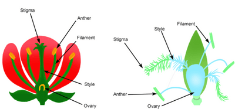
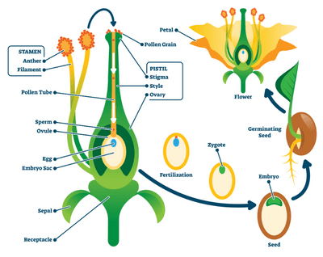

## Reproduction in Plants

| Insect Pollinated Plants | Wind Pollinated Plants |
|----|----|
| Stamens are enclosed | Stamens are exposed |
| Stigma is enclosed | Stigma is exposed |
| Stigma is sticky, so pollen grains attach to the stigma from the insect | Stigma is feathery to catch the pollen grain blown by the wind |
| Petals are large | Petals are small |
| Petals are brightly coloured to attract insects | Petals are not brightly colored-usually green |
| Produce nectar | Nectar is not present |
| Pollen grains are larger and sticky to stick to insects' bodies | Pollen grains are smooth and inflated to carry in the wind |

 

* **Pollination:** When the pollen grain from the anther transfers to the stigma of the flower
* There are two types of pollination:
  * **Self-pollination**: Pollen of a flower lands in the stigma of a flower on the same plant
  * **Cross-pollination:** Pollen of a flower lands in the stigma of a flower on a different plant
* **Sexual reproduction in flowers**
  * Pollen grain from the anther of another flower attaches itself to the stigma of another flower of the same species.
  * The tube nucleus of the pollen grain grows a pollen tube down the style
  * The pollen tube grows into the ovary and then into the ovule.
  * The generative nucleus moves into the ovule, and **fertilisation** occurs; the nucleus of the pollen and the nucleus of the ova fuse to form a zygote.

 

|    | After Fertilisation |
|----|----|
| **Zygote** | Embryonic plant with plumule (small shoot) and radicle (small root) |
| **Ovule wall** | Seed coat/Testa |
| **Ovary wall** | Fruit coat |
| **Ovule** | Seed |
| **Ovary** | Fruit |

* Germinating seeds utilise food reserves until the seedling can carry out photosynthesis
  * A seed contains the plant embryo, consisting of the radicle, plumule and cotyledons
    * **Cotyledons** are part of the embryo that becomes a leaf in germinating plants
  * The seed stores food in the cotyledon or another part of the seed
  * The food store is used up during germination
* Plants can produce asexually by:
  * **Natural Methods**
    * Runners
    * Bulbs
    * Tuber
  * **Artificial Methods**
    * Cuttings

