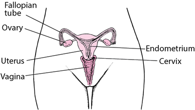
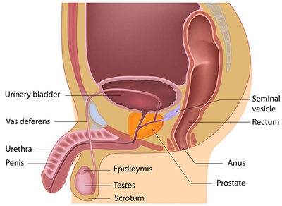
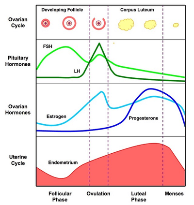
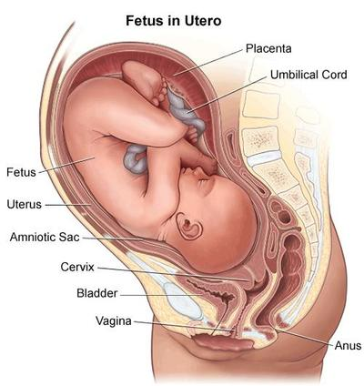

## Reproduction in Humans

### **Female Reproductive System**

* **Vagina:** Entry point for the penis
* **Cervix:** Separates the vagina from the uterus
* **Uretus:** Site of fetal development
* **Ovary:** Secreates the egg cells (ova) once every month
* **Fallopian tube/ oviduct:** Site of fertilisation

 

### **Male Reproductive System**

* **Testes:** The sperms are produced in the testes
* **Sperm Duct:** Transports sperm to urethra from ejaculation
* **Seminal Vesicles:** Contains a mixture called semen
* **Scrotum:** Holds the testes outside the body to keep them cooler than the body temperature for optimum sperm production.
* **Urethra:** Where urine and semen are transported to be deposited outside of the body

 

* The male gamete is the sperm, and the female gamete is the ovum (egg cell)
* Gametes divide by meiosis, producing cells that are not genetically identical.
  * These cells are **haploid**, having half of the original number of chromosomes.
* The zygote, formed by fertilisation, will have the original number of chromosomes (46 chromosomes in humans), creating a diploid cell.
* The zygote is divided by mitosis to form the embryo, which is transported down the fallopian tube and implanted in the uterus.
* The embryo would develop a placenta.
  * **Placenta**
    * Allows the embryo to obtain nutrients like glucose and amino acids, as well as oxygen, while getting rid of waster products such as carbon dioxide and urea
    * Secretes progesterone, which maintains the lining of the uterus
* During pregnancy, the **amnion** surrounding the embryo secretes **amniotic fluid** to protect the fetus and act as a shock absorber.
* For the baby to be born:
  * The cervix will dilate, and the muscles of the uterus contract to tear the amnion, and the amniotic fluid escapes.
  * The baby’s head is pushed through the cervix and then the vagina.
  * During afterbirth, the muscles of the uterus continue to contract, pushing the placenta out.
* **Testosterone** controls male secondary characteristics, while **oestrogen** controls female secondary characteristics.

| Girls | Boys |
|----|----|
| Menstrual cycle begins | Sperm production begins |
| Growth of armpit hair and pubic hair | Growth of facial, body and pubic hair |
| Development of sexual organs | Development of sexual organs |
| Breast develop | Increase in body mass and growth of muscles |

* **Ovulation:** Every month, an egg cell matures in the follicle and is released into an oviduct from one of the ovaries

   
* During intercourse, the egg may be fertilised and become a zygote
* If it is not fertilised, shredding of the uterus lining occurs, called a **period**:
  * A menstrual cycle is a continuous process.
  * The **pituitary gland produces the follicle-stimulating hormone (FSH)** and stimulates the follicle's growth.
  * In the middle of the cycle, the follicle bursts open, and ovulation occurs as the production of **luteinising hormone (LH)** (another pituitary hormone) peaks.
  * Once the follicle releases the egg cell, it becomes a **corpus luteum**, which secretes progesterone.
  * **The ovaries produce progesterone**, which helps to thicken and maintain the uterus lining. It also prevents the release of FSH and LH, which would stop ovulation.
  * The corpus luteum breaks down if the egg is not fertilised, and the lining of the uterus breaks down and passes out the vagina during **menstruation**.
  * After menstruation, the lining of the uterus is repaired by **oestrogen**, which is secreted in response to FSH. Oestrogen stimulates the production of LH and slows the production of FSH.

 