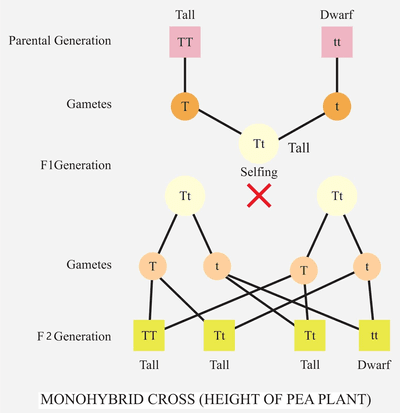

## Inheritance

* **Genome:** The entire DNA of an organism
* **Gene:** A section of a molecule of DNA that codes for a specific protein
* **Alleles:** Alternative forms of genes
* **Dominant allele:** An allele that is expressed in the heterozygous and homozygous
* **Recessive allele:** An allele that is expressed in the homozygous
* **Homozygous chromosomes: I**ndividuals carrying two identical alleles
* **Heterozygous chromosomes:** Individuals carrying two different alleles ( one dominant and one recessive)
* **Phenotype:** The characteristic expressed as a result of the genotype
* **Genotype:** The alleles an organism has for a certain characteristic
* **Codominance:** Pattern of inheritance where both alleles are expressed in the phenotype

### **DNA**

* The nucleus of a cell contains chromosomes on which genes are located
* A **DNA** ( deoxyribonucleic acid) molecule is two strands coiled to form a double helix.
* The strands are linked by hydrogen bonds between the complementary base pairs:
  * **Adenine** (A) is complementary to **thymine** (T)
  * **Cytosine** (C) is complementary to **guanine** (G)

| DNA | RNA |
|----|----|
| Double-stranded | Single-stranded |
| Has the base thymine | Has the base uracil instead of thymine |
| Deoxyribose sugar | Ribose sugar |

* **Stages of Protein Synthesis**
  * **Transcription:**
    * Part of the DNA unwinds
    * DNA helicase breaks down the hydrogen bonds between the complementary base pairs of a DNA
    * The DNA strands are now exposed.
    * The DNA polymerase brings the nucleotides complementary to the template strand, and the bases are paired according to the base-pairing rule.
    * The mRNA strand forms
    * The mRNA leaves the nucleus via the nuclear pores and enters the cytoplasm.
  * **Translation**
    * In the cytoplasm, the mRNA attaches to a ribosome
    * The tRNAs have anticodons complementary to the codons on the mRNA.
      * The codons are a triplet base sequence that codes for one amino acid
    * The tRNAs bring the amino acids that are coded for and carry them to the ribosome
    * The anticodons of the tRNAs pair complementarily with the codons of the mRNA
    * The amino acids form peptide bonds with each other
    * At the end of the mRNA, the stop codon stops the process, and the amino acids form a polypeptide chain, eventually becoming a protein.
* **Polygenic Inheritance:** Characteristics that are controlled by two or more genes. A good example is human height.
* Most phenotypic features are the result of polygenic inheritance.
* A **Monohybrid Cross** for homozygous tall and short parent plants:

   
* A **Pedigree Diagram** is a diagram showing a family tree for an inherited characteristic

### **Cell Division**

* **Mitosis (PMAT)**
  * **Prophase**
    * Chromatin condenses to form chromosomes.
    * A chromatid is one of the two identical halves of a chromosome that has been replicated.
    * The chromatids are joined at a centromere.
    * The nuclear membrane breaks down.
  * **Metaphase**
    * The centrosomes, where spindles are produced, move to opposite poles.
    * Spindle fibres form.
    * The chromosomes line up at the metaphase plate.
    * The spindle fibres attach to the centromere of the chromosomes.
  * **Anaphase**
    * Spindle fibres shorten and pull the chromatids to the opposite poles of the cell.
    * The chromatids separate to become chromosomes of the two daughter cells.
  * **Telophase**
    * Two nuclei form at the opposite poles of the cell.
    * The cytoplasm starts to divide, producing two daughter cells.
* Division of a diploid cell by mitosis produces two cells that contain identical sets of chromosomes.
* Mitosis occurs during growth, repair, cloning and asexual reproduction.
* Gametes are produced by **meiosis.**
* Division of a cell by meiosis produces four cells, each with half the number of chromosomes, and this results in the formation of genetically different haploid gametes.
* Random fertilisation produces genetic variation in offspring
* The diploid number of chromosomes in human cells is **46**, and haploid cells contain **23** chromosomes.
* One pair of chromosomes from your 23 pairs is your sex chromosome: XX for females and XY for males.

### **Mutations**

* **Mutation:** A rare, random change in genetic material.
* **The incidence of mutations can be increased by:**
  * Exposure to ionising radiation: Gamma rays, x-rays and ultraviolet rays
  * Chemical mutagens: chemicals in tobacco
* A change in DNA can affect the phenotype by altering the sequence of amino acids in a protein
* Most genetic mutations do not affect the phenotype; some have a small effect and rarely a significant one.

### **Natural Selection and Evolution**

* **Antibiotics** are chemicals that kill or reduce the growth of microorganisms
* They are used mainly for bacterial infections and can not treat viral infections
* Penicillin: Antibiotic used to treat bacterial infections that are made from the mould Penicillium
* **Resistance to antibiotics can increase in bacterial populations.**
  * Resistance starts when a random mutation gives a bacterium resistance to a particular antibiotic.
  * The resistant bacterium has an advantage over non-resistant bacteria of the same species.
  * Therefore, the resistant bacterium will survive and reproduce.
  * The antibiotic will not kill the resistant bacteria.
  * The bacteria evolve due to natural selection.
* **Natural Selection**
  * There is variation within the species
  * Mutations can occur
  * Changing conditions in the environment would favour a species with a selective advantage.
  * The species with the selective advantage is more likely to survive, so reproduces.
  * The alleles are passed on to the offspring.
  * The frequency of the species that are less adapted decreases.

