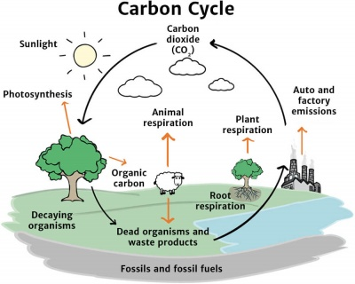
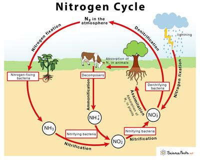

## Cycles Within Ecosystems

### **The Carbon Cycle**

 

* **Respiration:** When organisms like animals and plants respire, the carbon returns to the atmosphere as carbon dioxide.
* **Photosynthesis:** Plants use carbon dioxide in the air for photosynthesis.
* Animals consume plants and take some of the carbon with them.
* **Decomposition:** When plants and animals die, decomposers use oxygen (in respiration) and break down their dead bodies, returning the carbon they consume to the atmosphere.
* The dead remains, and the faeces that are not broken down are slowly converted to fossil fuels.
* **Combustion:** Fossil fuels are burnt and undergo combustion, which releases huge amounts of carbon dioxide into the atmosphere

### **The Nitrogen Cycle**

 

* **Nitrogen Fixation:** Nitrogen-fixing bacteria found in soils and the root nodules of leguminous plants convert **nitrogen gas** in the air to **ammonia.**
* **Nitrification:** Nitrifying bacteria converts the **ammonia** to **nitrites** and then to **nitrates.**
* **Assimilation:** Plants then use nitrates to make proteins, which, when consumed by an animal, pass the nitrogen to the organism.
* When plants or animals die, soil decomposers such as bacteria and fungi convert the nitrates to ammonia.
* **Denitrification:** Denitrifying bacteria turns the nitrates back into nitrogen gas.

