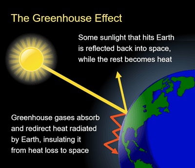
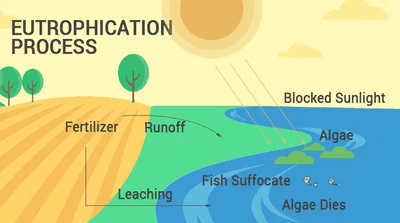

## Human Influences on the Environment

### **Air Pollution**

* **Carbon monoxide**
  * Haemoglobin in the red blood cells binds with the CO in the air instead of oxygen.
  * Less oxygen is transported to cells
  * Less energy is produced from respiration
  * This leads to fatigue and sometimes death
* **Sulfur dioxide**
  * Sulfur dioxide in the air reacts with rainwater to form sulfuric acid ( acid rain)
  * Acid rain is caused by sulfur dioxide and oxides of nitrogen.
    * Lowers the pH of water in the lakes, causing the organisms sensitive to pH to die
    * Lowers the pH of the soil, so trees and plants die
    * Corrosion of statues and monuments

### **The Greenhouse Effect**

* The sun releases short-wave radiation (e.g. ultraviolet and visible light), which passes through the atmosphere and strikes the earth
* The earth absorbs this energy and now radiates it as long-wave radiation (e.g. infra-red)
* The greenhouse gas molecules in the atmosphere cause the radiation to be reflected to the Earth’s surface, causing the temperature of the atmosphere to rise
* **Greenhouse gases** include:
  * Carbon dioxide
  * Water vapour
  * Methane
  * Nitrous oxide
  * CFCs

 

### **Human Activities that Contribute to Greenhouse Gases**

* Increasing greenhouse gases produces an enhanced greenhouse effect, which may lead to global warming.
* Human activities contributing to **carbon dioxide**:
  * **Deforestation:** Plants take in carbon dioxide to be used for photosynthesis. As deforestation increases, the number of trees decreases, so massive carbon dioxide levels remain in the atmosphere.
  * **Fossil fuels:** Burning fossil fuels  (e.g. coal and oil) in industries releases significant levels of carbon dioxide in the air.
* Human activities contributing to **methane:**
  * Humans feed on cattle, so the number of cattle increases with the increase in the human population. Cattle release methane as a waste product; hence, the increasing livestock population increases the amount of methane in the air.
* Human activities contributing to **nitrous oxide:**
  * Burning of fossil fuels
  * Exhaust of motor vehicles

### **Consequences of Global Warming**

* Melting of glaciers
* Sea levels rising
* Flooding of low-lying areas
* Habitat destruction
* Migration of species

### **Water Pollution**

* Water pollution is caused by leaching minerals in fertilisers and sewage disposal in water bodies.
* Fertilisers in the soil get washed away in the process of leaching.
* Minerals in fertilisers (especially nitrates) and sewage cause **eutrophication** when they enter water bodies.
  * Algae feed on minerals found in sewages and rapidly grow
  * This causes the formation of an algal bloom
    * Blocks light from reaching plants.
    * This prevents them from performing photosynthesis.
  * Plants die due to the lack of light
  * Aerobic bacteria decompose the algae
    * The bacteria use up oxygen during decomposition
  * Oxygen levels drop
  * The water becomes anoxic, and many aquatic organisms die

     

### **Effects of Deforestation**

* **Leaching:** With fewer trees, fewer roots hold the soil together, causing the soil to dry. This causes surface run-off during rain, leading to minerals leaching from the soil.
* **Soil Erosion**: As there are fewer trees to protect the soil, the rain washes away the soil, or the soil can be blown away
* **Disturbance of Evapotranspiration and the Carbon Cycle**
  * As more trees are burnt due to deforestation, more carbon dioxide is released into the atmosphere, disturbing the carbon cycle
* **Imbalance of Atmospheric Gases:** As trees take in carbon dioxide for photosynthesis, deforestation causes more carbon dioxide to remain in the air and less oxygen to be produced.
* **Loss of biodiversity**
* **Loss of medicinal plants**
* **Climate change**

