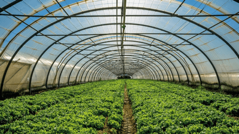
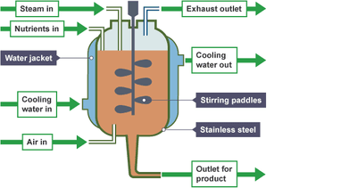
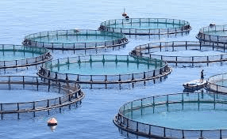

# Use of Biological Resources

## Food Production

### **Crop Plants**

* **Glasshouses** and **polythene tunnels** increase crop yield by providing optimum conditions such as:
  * **Light**
    * Artificial lighting is provided during winters
    * Greenhouses have transparent walls that allow natural light to enter for photosynthesis during the summer.
  * **Temperature**: The glasshouse can be heated to raise the temperature if the outside temperature is too low.
  * **Carbon Dioxide**: During cold seasons, the structures provide heaters that burn fossil fuels to raise the temperatures, which in return increases the carbon dioxide concentration, hence increasing the rate of photosynthesis

     
* **Fertilisers increase crop yield** as they provide required nutrients such as:
  * **Phosphates:** Makes DNA and is a part of cell membranes
  * **Nitrates**: Makes DNA and amino acids required for the growth of the plant
* A **pest** is any organism that reduces the yield of crops.
* **Pesticides** are chemicals applied to crops to kill the pest.
* Types of chemical pesticides
* Fungicides kill fungi
* Herbicides kill weed
* Insecticides kill insects

| Advantages | Disadvantages |
|----|----|
| Can effectively kill all pests | Pests can develop resistance over |
| Highly available | Can be washed away into water bodies, harming organisms |
| They’re stable and fast-acting | Requires reapplying consistently |

* **Biological Control:** A control of a pest by introducing a natural predator

  Examples of biological control include:
  * **Introducing a natural predator** - for example, ladybirds can be used to control the populations of aphids in orange groves
  * **Introducing a pathogenic (disease-causing) microorganism**
  * **Introducing sterile males**
  * **Using pheromone**

| Advantages | Disadvantages |
|----|----|
| Doesn’t involve chemicals | A slow-paced process |
| Doesn’t need reapplying, unlike chemical pesticides |    |
| Longer-term solution |    |

### **Microorganisms**

* **Bread Production**
  * Yeast is used to make bread.
  * The yeast is added once flour and water are mixed, forming the bread dough.
  * The yeast respires the sugars, which are broken down from starch by enzymes in the cereal
  * Initially, the yeast respires aerobically, producing water and carbon dioxide. The carbon dioxide makes the dough rise.
  * The yeast respires anaerobically when oxygen runs out, forming alcohol and carbon dioxide.
  * When the bread is baked, the gas bubbles expand to give it light texture.
  * Baking kills the yeast cells and evaporates ethanol produced from fermentation.
* **Yoghurt Production**
  * Sterilize all equipment to avoid contamination
  * Pasteurize the milk:
    * Heat it at 85-95°C for 15-30 minutes
  * Homogenize the milk to disperse the fat globules
  * Cool the milk to around 40-45°C.
  * Add the lactobacillus to the milk, then incubate it for 3-6 hours.
    * During this, the lactobacillus will break down the lactose in milk to lactic acid, which drops the pH and forms the yoghurt texture.
  * The thickened yoghurt is cooled to 5°C, and flavourings may be added.
* **Industrial Fermenters**

   
  * **Inlet:** Nutrients are fed in through open and closed pipes.
  * **pH probes:** The pH of the contents can be adjusted by adding acid or alkali to keep it constant.
  * **Air inlet:** For microorganisms that respire aerobically, filtered air is supplied. It is filtered to prevent contamination
  * **Stirring paddles:** Mix up the contents to ensure:
    * The microorganisms get more exposure to the nutrients
    * Keep the temperature even throughout the vessel
  * **Cold water Outlet:** Since fermentation produces heat, the fermenter is surrounded by a cold water jacket to prevent overheating.
  * **Temperature probes**
  * **Steam inlet:** Prevents contamination by providing aseptic conditions, pumping steam at high pressures

### **Fish Farming**

 

* Fish farms are confined places where fish are bred for commercial purposes, providing a source of protein for the increasingly growing population.
* Fish farming optimising the growth of fish by:
  * **Maintaining water quality**
  * **Controlling intraspecific and interspecific predation:**
    * **Interspecific predation** is predation between different species
    * This can be avoided by using a net over each species
    * **Intraspecific predation** is predation between the same species
    * This can be avoided by providing sufficient food, separating the fish by age and size
  * **Controlling disease:** use pesticides to kill pests like sea life
  * **Add antibiotics to the waters** To prevent the spread of disease
  * **Removing waste products:** Remove all dead fishes and their waste to avoid infections on other fishes
  * **Selective Breeding:** Large fish that need less food for growth are chosen for selective breeding, and the desired offspring is then bred

