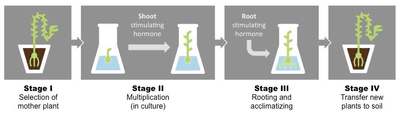
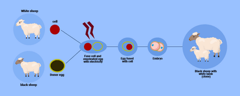

## Cloning

* **Cloning**: the process of producing genetically identical organisms

### **Plants**

* Plants can undergo cloning in either of two ways: cutting or micropropagation.
* **Cuttings**
  * Farmers cut off a stem from the plant with the desired trait
  * Place the stem in a rooting powder to help it grow roots and plant it after a while
  * The grown plant is genetically identical to the parent plant
* **Micropropagation**
  * The tips of the stems and shoots are removed from the plant.
    * These are called explants.
  * The explants are sterilised to kill any microorganisms.
  * Placed them in a sterile agar medium containing nutrients and plant hormones
  * When the explants have grown roots, they are transferred to greenhouses and transplanted into compost.

     
* **Advantages of Micropropagation**
  * Large numbers of genetically identical plants
  * Production is quick
  * species that are difficult to grow from seed or cuttings can be propagated by this method
  * plants can be produced at any time of the year
  * large numbers of plants can be stored easily (many can be kept in cold storage at the early stages of production and then developed as required)
  * genetic modifications can quickly be introduced into thousands of plants after modifying only a few.

### **Animals**

* One example of an animal that had been cloned is a sheep named Dolly.
* **Process of Cloning**
  * An adult body cell is isolated
  * The nucleus is removed from the cell
  * An unfertilized egg cell is taken from another parent, and its nucleus is removed. The nucleus is now enucleated.
  * Insert the nucleus from the adult body cell into the empty egg cell of the second sheep.
  * Give the cell an electric shock to stimulate the egg cell to divide by mitosis into an embryo.
  * Implant the embryo into the uterus of a surrogate mother
  * This process produces the clone

     

