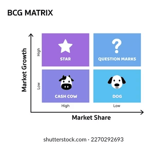

## **Product**

### **Key Vocabulary**

These are the elements of a firm’s marketing that are designed to meet the needs of consumers. They are:

* **Product**
* **Price**
* **Place**
* **Promotion**

### **Product development**

Products are needed to be produced in order for a business to trade. However, sometimes businesses may produce products while trading. These may be because the existing product is getting out of date or to build up a competitive edge in the market.

In order to produce a product there are few stages:

1. **Generating ideas**: these may come from various sources such as: owners or research and development centers.
2. **Analysis**: after the ideas are being generated businesses are required to analyze the ideas and filter them, choosing the best, marketable, profitable and legal idea.
3. **Development**: this is where experiments and simulations may be carried out and the product is produced as expected.
4. **Test marketing**: this is when the product is being tested in a market and sample is taken to be as a representative of the whole market.
5. **Commercialization and launch**: this is where the business modifies the product finally and launches it nationally.

**Packaging**

* Consumers link the quality of the product through the neatness and beauty of the packaging.
* It helps businesses to display their brand name and increase their image and reputation.
* It helps consumers differentiate it from the rivals.

### **Product life cycle**

* **Development**: there is no sale. This is where the product is being made, tested and analyzed. Lump amount of money is spent on research and development and the costs are high.
* **Introduction**: product is being introduced with huge parties/promotions. Pricing strategies are implemented and costs still remain high while there is a slight increase in the revenues.
* **Growth**: if the product is successful the revenues starts to increase significantly. Line is steeper in the graph and costs are beginning to be recovered. At the end of this phase revenues starts to fall as competitors are emerging with their own products of the same type.
* **Maturity**: revenues begin to fall and the costs are fully recovered. Cash flow is improved and business is making a profit. More rivals and therefore, some businesses are forced out or their promotion techniques changes. Some businesses use extension strategies to lengthen the lifecycle.
* **Decline**: this is where the product is out of date or not trending due to changes in tastes and fashions or advancement of new technologies. Some businesses bring out new products to replace the declining products.

### **Extension strategies**

These are the methods that are used to lengthen the life of a product. Some methods are:

* Changing the appearance of the product.
* Encouraging more frequent use of the product.
* Finding new markets for the products.

**Advantages of using extension strategies**

* Brand image is improved.
* Costs of developing new brands are saved.
* Competitors may find it difficult to enter the market.

**Disadvantages of using extension strategies**

* They are expensive.
* They may damage the brand image if extended product is a failure.

### **Managing and reviewing the product portfolio**

Product portfolio is a range of product a business is currently marketing. A business has to manage the product by constantly reviewing each product and making changes whenever necessary.

A **Boston matrix** may be used to analyze a product marketed by a business while categorizing it according to the market share and market growth.

The Boston matrix puts the products into 4 categories:

1. **Stars**: valuable products for a business while having a high market share and growth.
2. **Cash cows**: mature products with high market share but low market growth while generating a steady income.
3. **Question marks**: potential products with lower market share but higher market growth.
4. **Dogs**: declining products with low market share and growth.

 