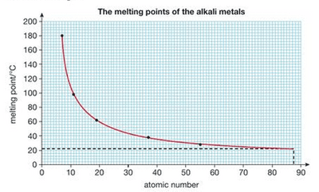

## Predicting Properties

* We can **predict the properties of francium** because we know the trends in the properties of the elements above it in Group 1.

*The melting points of the alkali metals: melting point decreases going down the group, so the trend can be used to predict the melting point of francium.*

* Francium will:

  * Be very soft

  * Have a density over $2\ g/cm^3$

  * Have a melting point around room temperature

  * Be more reactive than caesium

  * Tarnish almost instantly in air

  * Form colourless compounds and colourless solutions

  * Form francium hydroxide when it reacts with water, giving an alkaline solution due to the presence of $OH^-$ ions

$$
2Fr(s) + 2H_2O(l) \rightarrow 2FrOH(aq) + H_2(g)
$$
